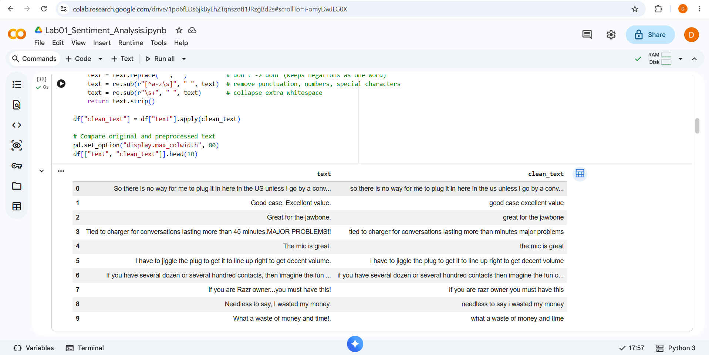
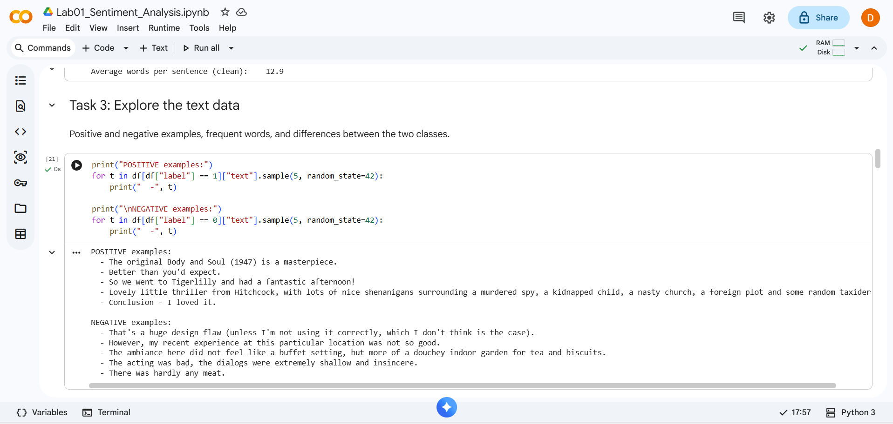
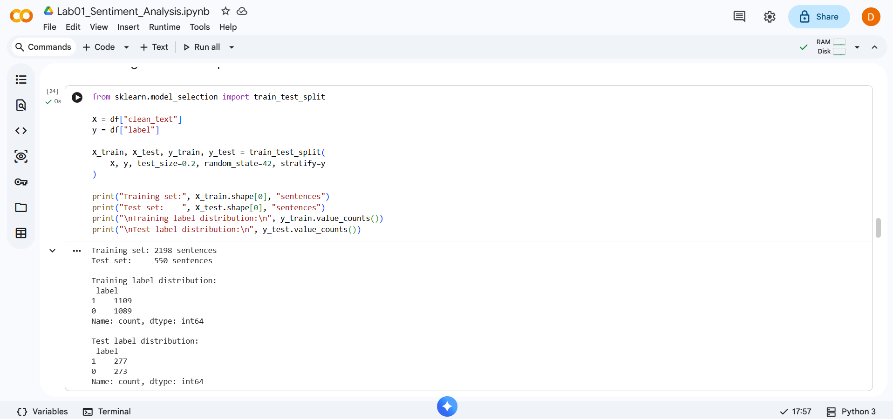
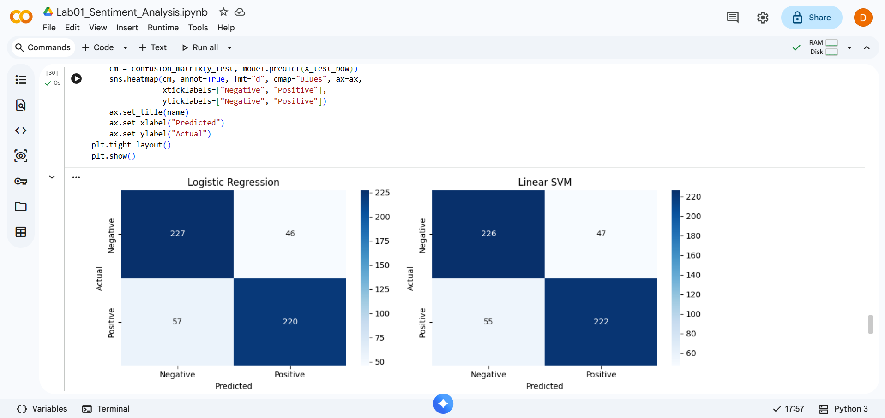
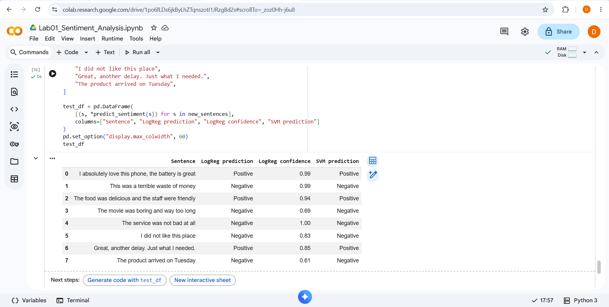

# Lab 01 - Sentiment Analysis Using Traditional Machine Learning

**Module:** PUSL 3205 Large Language Models and Generative AI

**Notebook (Python code):** [notebook/Lab01_Sentiment_Analysis.ipynb](notebook/Lab01_Sentiment_Analysis.ipynb)

## 1. Laboratory Session
Lab 01 - Sentiment Analysis Using Traditional Machine Learning

## 2. Objective
The goal of this lab was to teach a computer to read a short sentence and decide if it is **positive** or **negative**, using simple (traditional) machine learning. I practised the basic steps of working with text: cleaning it, turning words into numbers, training models, checking how good they are, and testing them on my own sentences.

**Dataset:** UCI Sentiment Labelled Sentences. It has reviews from Amazon, IMDB and Yelp, 2,748 sentences in total. Each sentence is labelled 1 (positive) or 0 (negative).

**Tools used:** Python, Google Colab, Pandas, NLTK, Scikit-learn, Matplotlib, Seaborn.

## 3. Tasks and Implementation

### Task 1 - Download and load the dataset
I downloaded the three files and joined them into one table with three columns: the sentence (`text`), the label (`label`) and where it came from (`source`). There are 1,386 positive and 1,362 negative sentences, so the data is almost perfectly balanced.


### Task 2 - Clean the text
Computers work better with clean text, so I wrote a function called `clean_text()` that:
- changes everything to lowercase,
- removes apostrophes (so "don't" becomes "dont" and stays as one word),
- removes punctuation and numbers,
- removes extra spaces.

The cleaned sentence is saved in a new column called `clean_text`.

```python
def clean_text(text):
    text = text.lower()
    text = text.replace("'", "")
    text = re.sub(r"[^a-z\s]", " ", text)
    text = re.sub(r"\s+", " ", text)
    return text.strip()
```

Below is the original text next to the cleaned text, and the average sentence length before and after cleaning.




### Task 3 - Explore the data
I looked at some positive and negative examples, and then counted the most common words. I did this for all sentences, and then separately for positive and negative ones (without common filler words like "the" and "and" in the last charts).




### Task 4 - Split the data
I kept 80% of the sentences for training the model (2,198 sentences) and 20% for testing it (550 sentences). I made sure both parts have about the same number of positive and negative sentences.



### Task 5 - Turn words into numbers (Bag-of-Words)
A model cannot read words, so I used Bag-of-Words (BOW). It makes a list of all the different words (4,475 of them) and, for each sentence, counts how many times each word appears. I built the word list from the training data only, so the model never sees the test data in advance.


### Task 6 - Train the models
I trained two models on the BOW numbers: **Logistic Regression** and **Linear SVM**.

### Task 7 - Check how good the models are
I tested both models on the 550 sentences they had never seen, and measured accuracy, precision, recall and F1-score.




### Task 8 - Try new sentences
I wrote 8 new sentences to see what the model would say. Four were easy, and four were tricky: two with "not", one sarcastic and one neutral.



## 4. Results and Evidence

**How well did the models do?** (Precision, recall and F1 are for the positive class.)

| Model | Accuracy | Precision | Recall | F1 |
|---|---|---|---|---|
| Logistic Regression | 0.8127 | 0.8271 | 0.7942 | 0.8103 |
| Linear SVM | 0.8145 | 0.8253 | 0.8014 | 0.8132 |

**Confusion matrices** (rows are the real label, columns are the model's guess):

| | LogReg: said Negative | LogReg: said Positive | SVM: said Negative | SVM: said Positive |
|---|---|---|---|---|
| Really Negative | 227 | 46 | 226 | 47 |
| Really Positive | 57 | 220 | 55 | 222 |

**My new sentences:**

| Sentence | Model said | Right? |
|---|---|---|
| I absolutely love this phone, the battery is great | Positive (0.99) | Yes |
| This was a terrible waste of money | Negative (0.99) | Yes |
| The food was delicious and the staff were friendly | Positive (0.94) | Yes |
| The movie was boring and way too long | Negative (0.69) | Yes |
| The service was not bad at all | Negative (1.00) | No, it should be positive |
| I did not like this place | Negative (0.83) | Yes |
| Great, another delay. Just what I needed. | Positive (0.85) | No, it is sarcasm |
| The product arrived on Tuesday | Negative (0.61) | Neutral, so there is no right answer |

## 5. Observations

**Cleaning the text.** Cleaning changed the text only a little. The average length went from 13.01 to 12.9 words per sentence, mostly because numbers were removed. I was surprised that "minutes.MAJOR PROBLEMS!!" became "minutes major problems". Replacing punctuation with a space kept the words apart, but removing "!!" took away the strong feeling in the sentence, which could have helped the model. I removed apostrophes on purpose so that "don't" stays as one word ("dont"). Otherwise it would split into "don" and "t", which means nothing.

**Looking at the words.** Positive sentences had words like *great*, *good*, *best* and *love*. Negative sentences had *bad* and *dont*. Many common words, such as *movie*, *film*, *phone*, *food* and *service*, appear in both groups. They tell us what the review is about, not whether it is good or bad. Also, "good" appears in the negative group, probably from phrases like "not good", which shows that Bag-of-Words does not understand word order. I also noticed that the top positive word ("great") appears about 190 times, while the top negative word ("bad") appears only about 95 times. Positive reviews seem to repeat the same few strong words, while negative reviews express problems in many different ways. This might make negative sentences harder to describe with a few key words.

**How good were the models?** Both models got about 81% right, and they were almost the same (81.27% and 81.45%). I expected the SVM to be clearly better, but it was only one sentence better out of 550. This taught me that changing the model does not help much when the real limit is the way the text is turned into numbers. Both models also made more mistakes on positive sentences (57 and 55 positive sentences called negative) than on negative ones (46 and 47 negative sentences called positive).

**Why "not bad at all" failed.** The model got "The service was not bad at all" wrong. It only counts words and does not understand how they work together. It saw the word "bad", which appears a lot in negative sentences, and decided the sentence was negative. It cannot tell that "not" turns "bad" into something positive. The confidence was 1.00, which shows that a model can be completely sure and still be wrong.

**Why the sarcastic sentence failed.** "Great, another delay. Just what I needed." was predicted positive because of the word "great". A person can tell from the situation that the writer is annoyed, but the model only sees words, not tone or situation.

**The neutral sentence.** "The product arrived on Tuesday" got the lowest confidence (0.61). The model only knows "positive" and "negative", so it was forced to choose one, even though the sentence is neither.

**Challenges.** The hardest part was deciding what to remove during cleaning. Removing too much (like filler words such as "not") can destroy the meaning of a sentence. I also had to learn that the word list must be built from the training data only, so the test stays fair.

## 6. Learning Outcomes
- I built a full text-classification process from start to finish: load, clean, explore, split, turn into numbers, train, evaluate and test.
- I learned how to clean text with Python and why each cleaning step is done.
- I understood how Bag-of-Words works, why it makes a very large table that is mostly zeros, and why it ignores word order.
- I learned to judge a model using accuracy, precision, recall, F1-score and a confusion matrix, not just one number.
- I understood why the test data must stay unseen (to avoid data leakage).
- I saw the limits of traditional machine learning with negation, sarcasm and context. This shows why more advanced models, such as Large Language Models, are needed, which is what the rest of the module covers.
