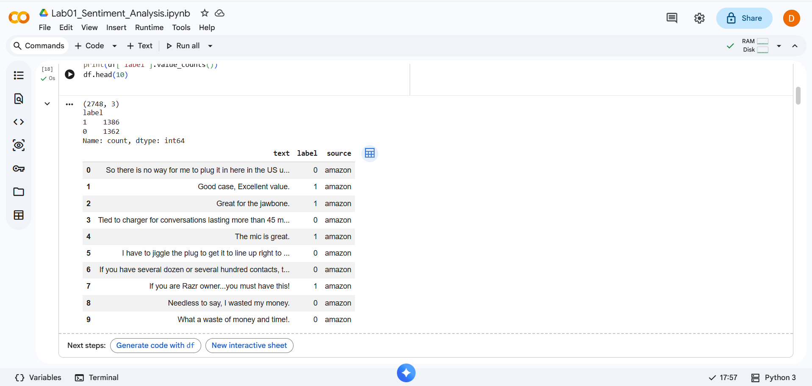
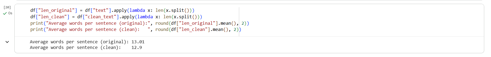
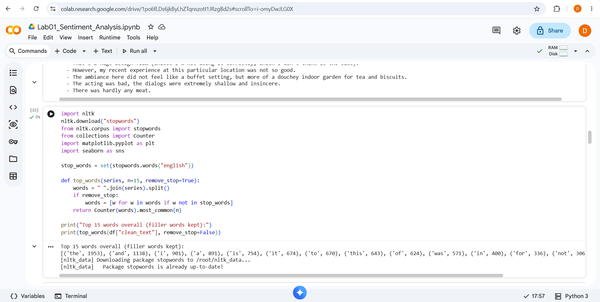
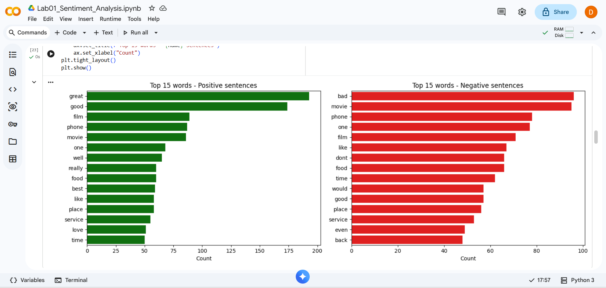
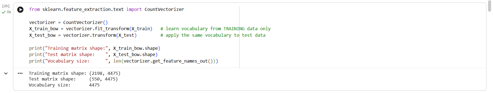
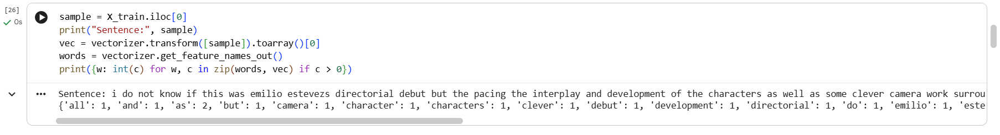
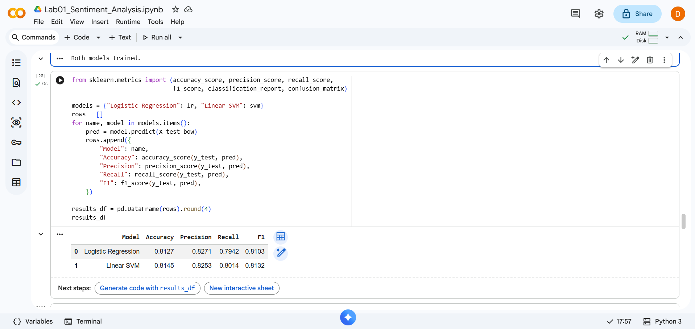
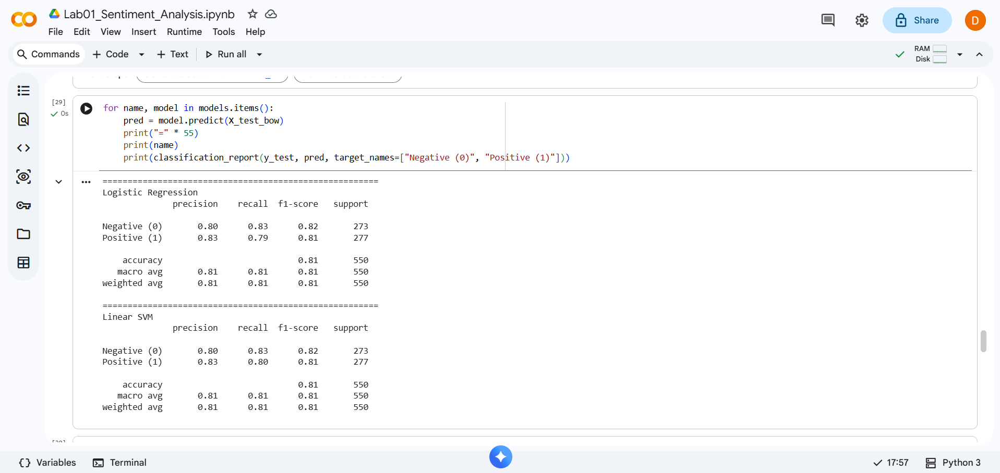

# Lab 01 - Sentiment Analysis Using Traditional Machine Learning

**Module:** PUSL 3205 Large Language Models and Generative AI

**Notebook:** [notebook/Lab01_Sentiment_Analysis.ipynb](notebook/Lab01_Sentiment_Analysis.ipynb)

## 1. Laboratory Session
Lab 01 - Sentiment Analysis Using Traditional Machine Learning (text preprocessing, Bag-of-Words and classical ML classifiers).

## 2. Objective
To practise a basic NLP workflow: clean raw text, convert it to numeric features with Bag-of-Words (BOW), train classical machine learning models to classify sentences as positive or negative, evaluate them, and test them on new sentences.

**Dataset:** UCI Sentiment Labelled Sentences (Amazon, IMDB and Yelp). Total 2,748 sentences, each labelled 1 (positive) or 0 (negative).

**Tools:** Python, Google Colab, Pandas, NLTK, Scikit-learn, Matplotlib, Seaborn.

## 3. Tasks and Implementation

### Task 1 - Download and load the dataset
The three files were downloaded and combined into one DataFrame with columns `text`, `label` and `source`. The data is almost balanced: 1,386 positive and 1,362 negative sentences.



### Task 2 - Text preprocessing
A `clean_text()` function was written to: convert to lowercase, remove apostrophes (so "don't" becomes "dont"), remove punctuation and numbers, and collapse extra whitespace. The result is stored in a new `clean_text` column.

```python
def clean_text(text):
    text = text.lower()
    text = text.replace("'", "")
    text = re.sub(r"[^a-z\s]", " ", text)
    text = re.sub(r"\s+", " ", text)
    return text.strip()
```




### Task 3 - Explore the text data
Positive and negative examples were displayed, and the most frequent words were counted overall and for each class (with NLTK stop words removed for the class charts).






### Task 4 - Split the dataset
80% training (2,198 sentences) and 20% testing (550 sentences), using a stratified split (`random_state=42`) so both sets keep the same class balance.


### Task 5 - Bag-of-Words representation
`CountVectorizer` was fitted on the training data only and then applied to the test data. This avoids data leakage. The vocabulary has 4,475 unique words.





### Task 6 - Train ML models
Two models were trained on the BOW features: Logistic Regression and Linear SVM.

### Task 7 - Evaluate model performance
Both models were evaluated on the 550 test sentences.






### Task 8 - Test with new sentences
Eight new sentences, including tricky ones with negation, sarcasm and a neutral statement, were classified.


## 4. Results and Evidence

| Model | Accuracy | Precision | Recall | F1 |
|---|---|---|---|---|
| Logistic Regression | 0.8127 | 0.8271 | 0.7942 | 0.8103 |
| Linear SVM | 0.8145 | 0.8253 | 0.8014 | 0.8132 |

(Precision, recall and F1 are for the positive class.)

Confusion matrices (rows = actual, columns = predicted):

| | LogReg: Pred Neg | LogReg: Pred Pos | SVM: Pred Neg | SVM: Pred Pos |
|---|---|---|---|---|
| Actual Negative | 227 | 46 | 226 | 47 |
| Actual Positive | 57 | 220 | 55 | 222 |

New sentence tests:

| Sentence | Prediction | Correct? |
|---|---|---|
| I absolutely love this phone, the battery is great | Positive (0.99) | Yes |
| This was a terrible waste of money | Negative (0.99) | Yes |
| The food was delicious and the staff were friendly | Positive (0.94) | Yes |
| The movie was boring and way too long | Negative (0.69) | Yes |
| The service was not bad at all | Negative (1.00) | No (should be positive) |
| I did not like this place | Negative (0.83) | Yes |
| Great, another delay. Just what I needed. | Positive (0.85) | No (sarcasm) |
| The product arrived on Tuesday | Negative (0.61) | Neutral sentence, no correct label |

## 5. Observations

**Preprocessing.** Cleaning changed the text only slightly: the average length went from 13.01 to 12.90 words per sentence, mostly because numbers were removed. A downside is that punctuation such as "!!" can carry emotion and is lost. Apostrophes were removed on purpose so that negations like "don't" stay as one word ("dont") instead of splitting into "don" and "t".

**Data exploration.** Positive sentences were dominated by words like *great*, *good*, *best* and *love*, while negative sentences were dominated by *bad* and *dont*. Many other frequent words (*movie*, *film*, *phone*, *food*, *place*, *service*) appear in both classes because they are topic words from the three sources, not sentiment words. The word *good* also appears in the negative class, probably from phrases such as "not good", which shows that BOW does not see word order. Stop words (including "not") were removed only for the charts, not for the model, because negation matters for sentiment.

**Model performance.** Both models reached about 81% accuracy, and the results were almost identical (SVM was only 1 sentence better out of 550). This suggests the limit comes from the BOW features rather than the choice of classifier. Both models made more false negatives (57 and 55 positive sentences predicted as negative) than false positives (46 and 47), so recall for the positive class was slightly lower than its precision.

**New sentences.** The model handled clear sentences well, with high confidence. It failed on "not bad at all" (confidently predicted negative, because the word *bad* is strongly negative and BOW cannot see that "not" reverses it) and on the sarcastic sentence (predicted positive because of the word *great*). The neutral sentence got the lowest confidence (0.61), because the model only knows two classes and has to choose one.

**Challenges.** Deciding how to treat apostrophes and stop words, because removing them can destroy negation. Also, working out that the BOW vectorizer must be fitted on the training data only.

## 6. Learning Outcomes
- Built a complete text-classification pipeline: load, clean, explore, split, vectorise, train, evaluate and test.
- Learned how to preprocess text with regular expressions and why each step is done.
- Understood the Bag-of-Words representation and why it is sparse and ignores word order.
- Learned to compare models using accuracy, precision, recall, F1 and confusion matrices.
- Understood data leakage and why the vectorizer is fitted on training data only.
- Saw the limits of traditional ML (negation, sarcasm, context), which motivates the use of Large Language Models later in the module.
