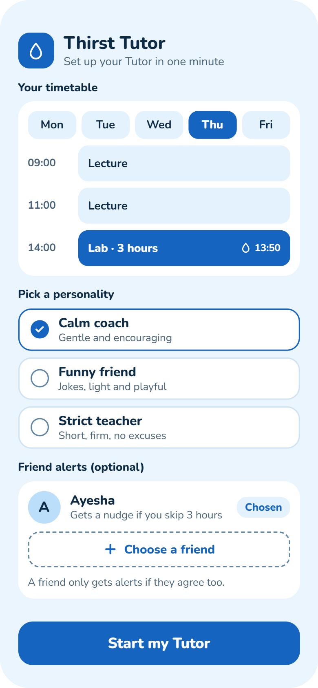
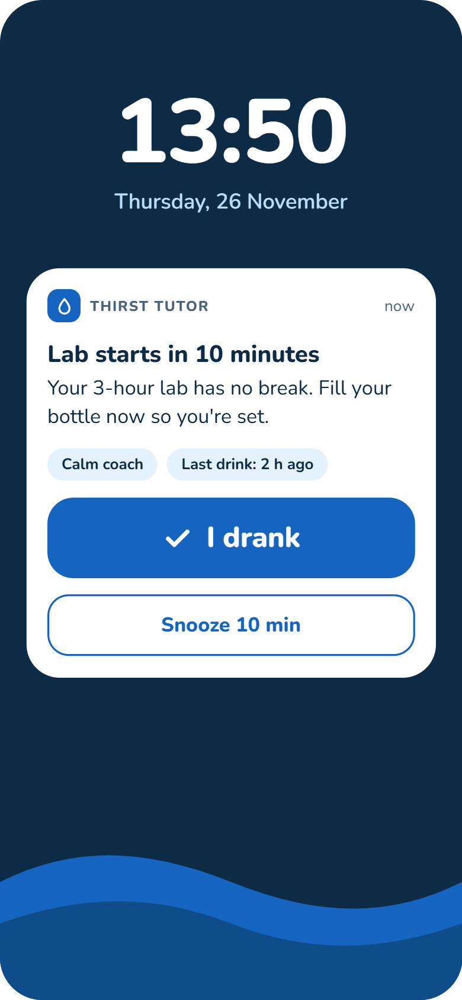
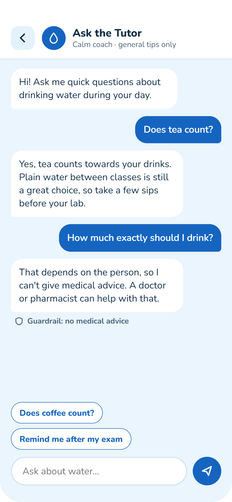
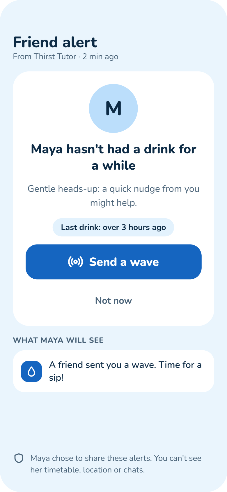
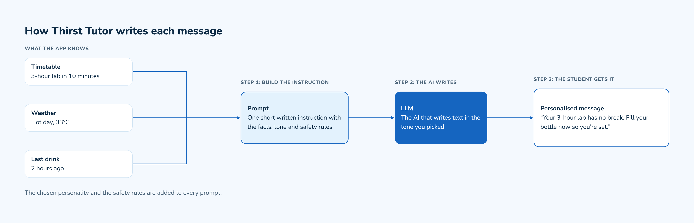
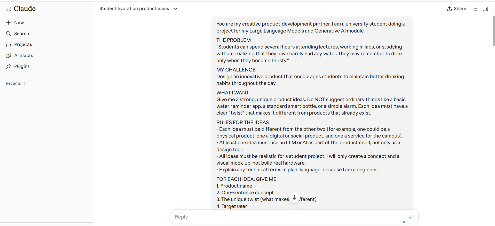
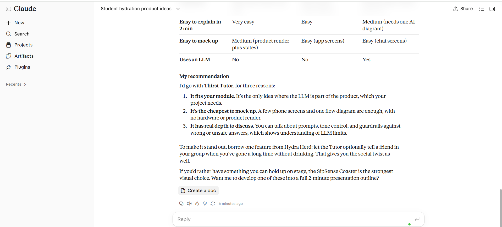
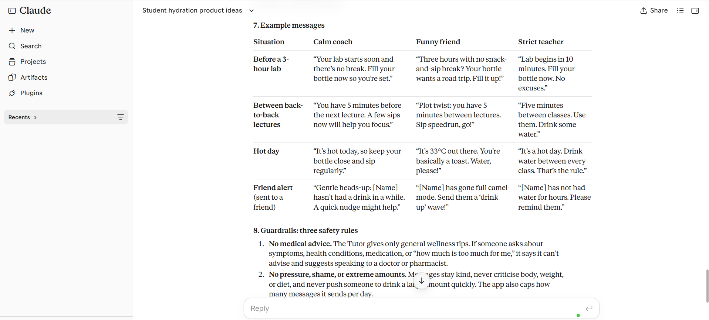

# Lab 02 - LLM in Everyday Life

## 1. Laboratory Session

- **Module:** PUSL 3205 Large Language Models and Generative AI
- **Lab:** Lab Sheet 02 - LLM in Everyday Life
- **Student:** Rubasinghe D D (Student ID 33680)
- **Problem chosen:** Group 4 - "The Dehydrated Student"

## 2. Objective

The aim of this lab was to see how an LLM can be used in everyday life as a partner for developing a new product. I had to:
- use an LLM to come up with and compare product ideas for a real everyday problem,
- choose one idea and turn it into a full product concept,
- explain how an LLM could be used inside the product itself,
- present the product with a simple visual mock-up.

My problem was that many students forget to drink enough water during busy days.

## 3. Tasks and Implementation

**Task 1 - Generate ideas.** I asked Claude for 3 product ideas for the dehydrated student problem. The first ideas (a smart cap, a refill streak app and a timetable reminder) were too simple and too close to products that already exist. I rejected them and wrote a stronger prompt with clear rules: be unique, no ordinary reminder apps, include an AI twist, explain technical words simply, and compare the ideas in a table.

**Task 2 - Choose one idea.** Claude gave 3 new ideas: SipSense Coaster, Hydra Herd and Thirst Tutor. I chose **Thirst Tutor**, an AI companion that reads the student's timetable and writes personal reminders. I also added the friend-alert feature from Hydra Herd. I chose it because the LLM is part of the product itself and it is easy to show without hardware.

**Task 3 - Develop the concept.** I asked Claude to turn the idea into a full concept: name, tagline, problem, target user, 5 features, how it works, how the LLM is used, example messages in three personalities, guardrails and limitations.

**Task 4 - Create a mock-up.** I asked Claude to build four phone screens (setup, notification, chat, friend alert) and a flow diagram. I checked that the names and details were consistent across the screens.

**Task 5 - Group activity files.** I wrote up the group activity in three files (listed in section 4).

## 4. Results and Evidence

### The product: Thirst Tutor
*"The hydration buddy that reads your timetable."*

It reads a student's timetable, finds the busy and long-gap moments, and uses an LLM to write a short, friendly reminder in the personality the student chose. A friend can also receive a gentle alert if the student has not drunk anything for a long time. Full details are in [activity-outcomes.md](group-activity/activity-outcomes.md).

### Mock-up

<table><tr>
<td align="center"><b>1. Setup</b>  </td>
<td align="center"><b>2. Notification</b>  </td>
<td align="center"><b>3. Chat</b>  </td>
<td align="center"><b>4. Friend alert</b>  </td>
</tr></table>

**Flow diagram:**

### Conversation with the LLM (selected screenshots)

**My improved prompt:**

**The three ideas and the recommendation:**

**Guardrails and limitations written for the product:**

All 15 screenshots are in the [screenshots](screenshots/) folder, and the step-by-step story is in [discussion-summary.md](group-activity/discussion-summary.md).

### Group activity files
- [group-members.md](group-activity/group-members.md) - who did the work
- [activity-outcomes.md](group-activity/activity-outcomes.md) - the full Thirst Tutor concept and mock-up
- [discussion-summary.md](group-activity/discussion-summary.md) - my process with the LLM

## 5. Observations

- **The prompt makes a big difference.** My first, short prompt gave simple and ordinary ideas. When I added rules, a required format and a request for something unique, the ideas became much more creative.
- **The LLM is a good partner, not the decision maker.** Claude produced ideas and wrote the concept, but I decided which ideas were too weak, which one to choose and why. I also checked its work, for example the names on the mock-up screens.
- **An LLM inside a product needs guardrails.** For Thirst Tutor, the LLM must not give medical advice, must not pressure or shame the user, and must protect privacy (for example, friends only see limited information). Without rules, the product could say something unsafe or unkind.
- **Limitations are real.** The product depends on the student logging their drinks, and an LLM can make mistakes or repeat the same messages.
- **Plain explanations helped.** Terms like IoT and prompt were new to me, and asking Claude to explain them simply helped me understand and make better choices.

## 6. Learning Outcomes

By completing this lab I learned to:
- use an LLM for brainstorming, comparing and developing product ideas,
- write a clear, detailed prompt with context, rules and a required output format,
- judge an LLM's answers instead of accepting the first result,
- explain how an LLM can be used inside a product (prompt, then LLM, then a personalised message),
- think about safety by adding guardrails and limitations,
- present an idea clearly using a mock-up and a flow diagram.

**Tools used:** Claude (idea generation, concept development and mock-up), GitHub (documentation).
