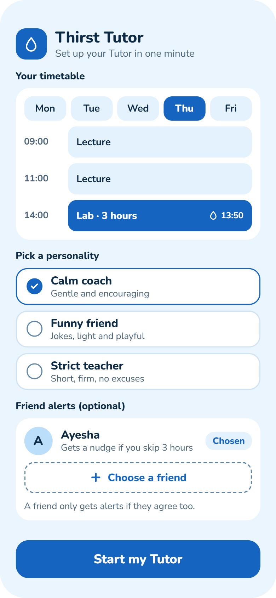
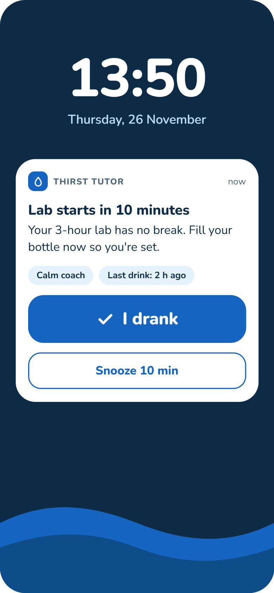
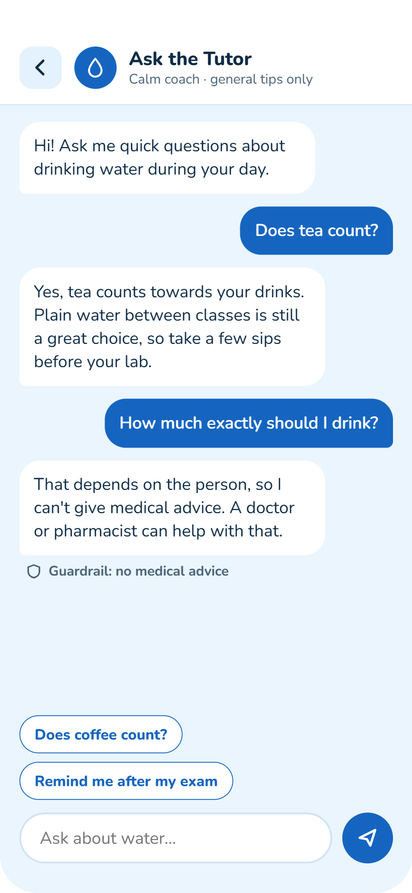
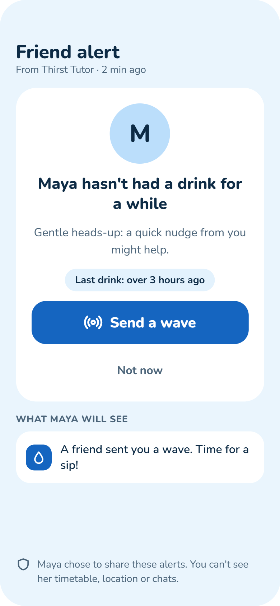
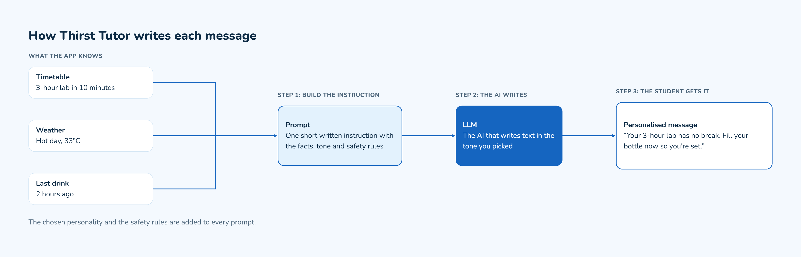

# Activity Outcomes - Thirst Tutor

## The challenge (Group 4 - The Dehydrated Student)
Students can spend several hours in lectures, labs or study sessions without realizing they have hardly had any water, and they often drink only when they become thirsty. The task was to design a product that encourages students to keep better drinking habits throughout the day.

## Final product: Thirst Tutor
**Tagline:** "The hydration buddy that reads your timetable."

**Product concept:** Thirst Tutor is a phone app with an AI companion that knows a student's timetable, the weather and when they last drank. It uses a Large Language Model (LLM) to write a short, personal reminder at the right moment, in a tone the student chooses.

**The problem it solves:** Students go hours without drinking because they are focused and only notice thirst late. Generic reminders do not help because they ignore what the student is doing, so they get muted within days.

**Target user:** University students with busy, irregular timetables (long labs, back-to-back lectures, exam periods) who already ignore ordinary reminder apps.

## Five key features
1. **Timetable-aware reminders:** messages are timed around the student's real classes, not a fixed clock.
2. **Choose-your-personality:** the student picks a calm coach, a funny friend or a strict teacher.
3. **Friend alerts:** an optional nudge is sent to a friend (only with their permission) when the student has gone a long time without a drink.
4. **One-tap logging:** tap "I drank" on the notification to record a drink without opening the app.
5. **Ask the Tutor:** a small chat for general questions such as "Does tea count?" or "Remind me after my exam."

## How it works
1. **Set up:** the student adds their timetable, picks a personality and chooses friends who can receive alerts.
2. **Watch the day:** the app tracks upcoming classes, the weather and the time since the last logged drink.
3. **Write the message:** at the right moment the app sends this information to the LLM, which writes a short message in the chosen personality.
4. **Respond:** the student taps "I drank", snoozes or chats back. If they go a long time without a drink, a chosen friend gets a gentle alert.

## How the LLM is used inside the product
The app does not send a fixed reminder. It builds a short written instruction (a **prompt**) and asks the LLM to write the message.

- **What goes in:** what is coming up (for example, "3-hour lab starts in 10 minutes, no break"), time since the last drink, the weather, the chosen personality, the type of message (reminder, friend alert or reply) and the safety rules.
- **What comes out:** one short message (about 25 words or fewer) that fits the situation and the chosen tone.

## Example messages

| Situation | Calm coach | Funny friend | Strict teacher |
|---|---|---|---|
| Before a 3-hour lab | "Your lab starts soon and there's no break. Fill your bottle now so you're set." | "Three hours with no snack-and-sip break? Your bottle wants a road trip. Fill it up!" | "Lab begins in 10 minutes. Fill your bottle now. No excuses." |
| Between back-to-back lectures | "You have 5 minutes before the next lecture. A few sips now will help you focus." | "Plot twist: you have 5 minutes between lectures. Sip speedrun, go!" | "Five minutes between classes. Use them. Drink some water." |
| Hot day | "It's hot today, so keep your bottle close and sip regularly." | "It's 33°C out there. You're basically a toast. Water, please!" | "It's a hot day. Drink water between every class. That's the rule." |
| Friend alert | "Gentle heads-up: [Name] hasn't had a drink in a while. A quick nudge might help." | "[Name] has gone full camel mode. Send them a 'drink up' wave!" | "[Name] has not had water for hours. Please remind them." |

## Guardrails (safety rules for the LLM)
1. **No medical advice.** The Tutor gives only general wellness tips. If someone asks about symptoms, health conditions, medication or "how much is too much for me", it says it cannot advise and suggests speaking to a doctor or pharmacist.
2. **No pressure, shame or extreme amounts.** Messages stay kind, never criticise body, weight or diet, and never push someone to drink a large amount quickly. The app also limits how many messages it sends per day.
3. **Protect privacy.** A friend only receives an alert if both people agreed. Alerts say only that the person has not had a drink, and never share the timetable, location or chat history.

## Limitations and how to reduce them
1. **It depends on the student logging drinks.** If they forget to tap "I drank", the app thinks they have not had water. *Fix:* make logging a single tap on the notification, and add an end-of-day "did I miss any?" check. In future, a sensor (like a smart coaster) could log drinks automatically.
2. **The LLM can make mistakes or get repetitive.** It might write something odd, inaccurate or too similar day after day. *Fix:* use a strict prompt with the guardrails, keep outputs short, and use pre-written backup messages if a reply looks wrong.

## Visual mock-up
The mock-up was created with Claude. It shows four phone screens and a diagram of how a message is made.

**1. Setup screen**

**2. Notification screen**

**3. Ask the Tutor chat screen** (the Tutor answers "Does tea count?" and refuses to give medical advice)

**4. Friend alert screen** (the alert a friend receives about the user, with the privacy note)

**How Thirst Tutor writes each message**

