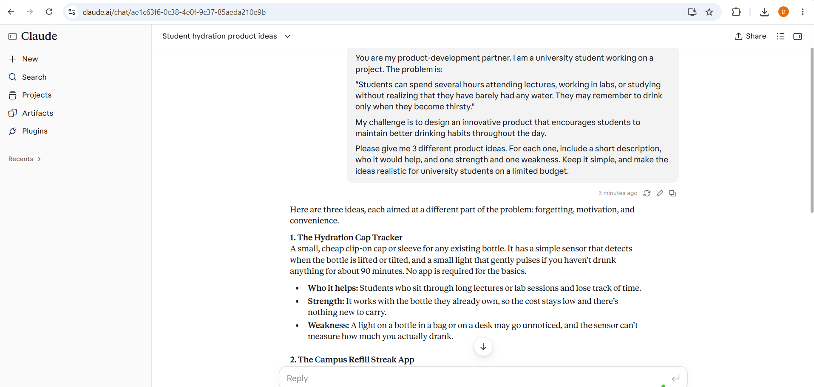
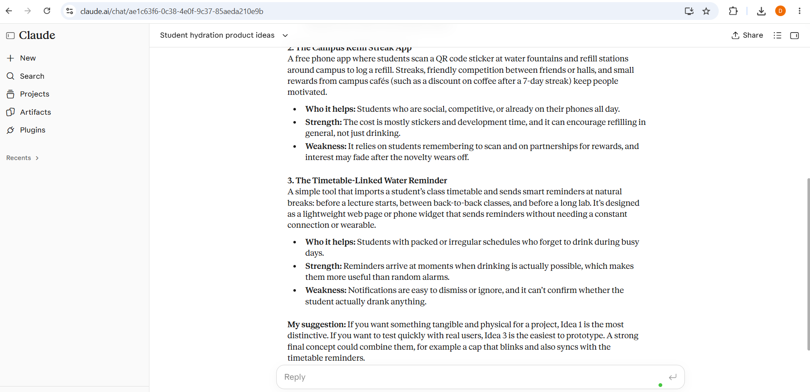

# Discussion Summary - How I Developed Thirst Tutor

Because I did this lab individually, this summary describes my own process of working with an LLM (Claude) as a product-development partner.

## Step 1 - First attempt: ideas that were too simple
I gave Claude the problem and asked for 3 product ideas with strengths and weaknesses. It suggested a **Hydration Cap Tracker** (a clip-on cap with a light), a **Campus Refill Streak App** (QR codes at refill points) and a **Timetable-Linked Water Reminder**.

I decided these were too simple and too close to products that already exist. The cap idea also depended on sensors and IoT, which I was not familiar with. I rejected all three and decided to ask for something more original.

## Step 2 - A stronger prompt
I started a new chat and wrote a more detailed prompt. It asked for 3 unique ideas, each with a clear "twist", told Claude not to suggest ordinary reminder apps or standard smart bottles, required at least one idea to use an LLM inside the product, and asked for plain-language explanations of any technical terms. It also asked for a comparison table and a recommendation.

Claude gave three ideas:
1. **SipSense Coaster** (physical): a desk coaster that glows when you have neglected your drink.
2. **Hydra Herd** (social): a shared virtual creature that stays healthy only if the whole friend group drinks.
3. **Thirst Tutor** (AI-powered): an AI chat companion that reads the student's timetable and writes personalised reminders using an LLM.

## Step 3 - My decision
I chose **Thirst Tutor**, with the friend-alert feature borrowed from Hydra Herd. My reasons were:
- The LLM is part of the product itself, not only a design tool, which fits this module.
- It is easy to show with phone screens and one flow diagram, with no hardware needed.
- It has real points to discuss: prompts, tone control and safety guardrails.
- Adding friend alerts gives it a social element and makes it more distinctive.

I did not take Claude's recommendation blindly. It also pointed out that the SipSense Coaster would be the strongest object to show on stage, but I preferred the idea that used an LLM inside the product.

## Step 4 - Developing the concept
I asked Claude to turn the idea into a full concept: name and tagline, the problem, target user, 5 features, how it works, how the LLM is used, example messages in three personalities, guardrails and limitations. The final result is in `activity-outcomes.md`.

The parts I found most useful were the guardrails (for example, the Tutor must not give medical advice) and the limitations (it depends on the user logging drinks, and an LLM can make mistakes or repeat itself).

## Step 5 - Creating the mock-up
I asked Claude to create a visual mock-up of four phone screens plus a flow diagram, in a blue water theme. I checked the screens afterwards. The friend names are consistent: Maya is the user, Ayesha is the friend chosen on the setup screen, and the friend alert screen shows what Ayesha receives about Maya.

## How I used the LLM
- **Brainstorming:** generating and comparing product ideas.
- **Developing:** turning a chosen idea into a complete concept.
- **Explaining:** describing unfamiliar terms (such as IoT, LLM and prompt) in plain language.
- **Designing:** building the phone-screen mock-up and the flow diagram.
- **My own part:** rejecting the first ideas, writing a better prompt, choosing the final idea and giving the reasons, and checking the results.

## Challenges
- My first prompt was too general, so the ideas were too simple. A more detailed prompt with clear rules (be unique, include an AI twist, no ordinary apps) gave much better results.
- Some technical ideas (like sensors and IoT) were new to me, so I asked Claude to explain them in plain language.
- I took a lot of screenshots at first, so I organised them in numbered order at the end.

## What I learned about using LLMs
- The quality of the answer depends on the quality of the prompt. Giving context, rules and a required output format works much better than a short request.
- An LLM is a good partner for brainstorming, but I still have to judge the ideas and make the decisions myself.
- When an LLM is part of a product, it needs guardrails, because it can give wrong or unsafe answers.
