# Lab 03 - Developing a Tiny Transformer Language Model

## 1. Laboratory Session

- **Module:** PUSL 3205 Large Language Models and Generative AI
- **Lab:** Lab Sheet 03 - Developing a Tiny Transformer Language Model
- **Student:** Rubasinghe D D (Student ID 33680)
- **Tools:** Python, PyTorch, Hugging Face Datasets, Google Colab (T4 GPU)
- **Notebook:** [Lab03_Tiny_Transformer.ipynb](notebook/Lab03_Tiny_Transformer.ipynb)

## 2. Objective

The aim of this lab was to build a very small version of the technology behind ChatGPT, a **Transformer language model**, and train it to write short children's stories. The model plays one game: *given the text so far, guess the next character.* By repeating this guess again and again, it can write a story.

In this lab I had to:
- load and explore the TinyStories dataset,
- turn text into numbers and make next-token training data,
- build a Transformer (embeddings, masked multi-head self-attention, feed-forward layers, residual connections, layer normalisation),
- train it, record the loss and measure perplexity,
- generate stories from a starting prompt,
- change the model settings and see what happens,
- save the trained model,
- discuss which mechanisms improve performance.

## 3. Tasks and Implementation

| Task | What I did |
|---|---|
| 1. Load the dataset | Loaded `roneneldan/TinyStories` from Hugging Face (streamed 20,000 stories), printed three stories and checked story lengths. |
| 2. Preprocess | Used a small subset of **5,000 stories** (4,186,738 characters). Tokenized at **character level**: 90 different characters, each given a number. Split 90% training / 10% validation. |
| 3. Training data | Made batches of 64 input sequences of 128 characters. The target is the same sequence shifted by one character, so the model must guess the next character at every position. |
| 4. Architecture | Wrote the Transformer in PyTorch: token embeddings, positional embeddings, masked multi-head self-attention, feed-forward layers, residual connections and layer normalisation. |
| 5. Initialise | 4 layers, 4 attention heads, embedding size 128, dropout 0.1 (**832,858 parameters**). Loss function: cross-entropy. Optimizer: AdamW, learning rate 0.001. |
| 6. Train | 3,000 steps (about 6.5 epochs): predict the next characters, calculate the cross-entropy loss, backpropagate and update the parameters. It took 125 seconds on a T4 GPU. |
| 7. Monitor | Recorded training and validation loss every 250 steps and plotted the loss curves. |
| 8. Evaluate | Calculated validation loss and perplexity on text the model never trained on. |
| 9. Generate | Gave prompts such as "Once upon a time" and let the model write. Also tried different temperatures. |
| 10. Model settings | Trained 4 more models with 1 or 8 layers and 1 or 8 heads, and compared them. |
| 11. Save | Saved the weights and the configuration, then reloaded them into a new model to prove they work. |

The optional Gradio chat window was not attempted.

## 4. Results and Evidence

### 4.1 Dataset
Average story length was 895 characters (shortest 205, longest 4,540). Most stories are between 500 and 1,000 characters.

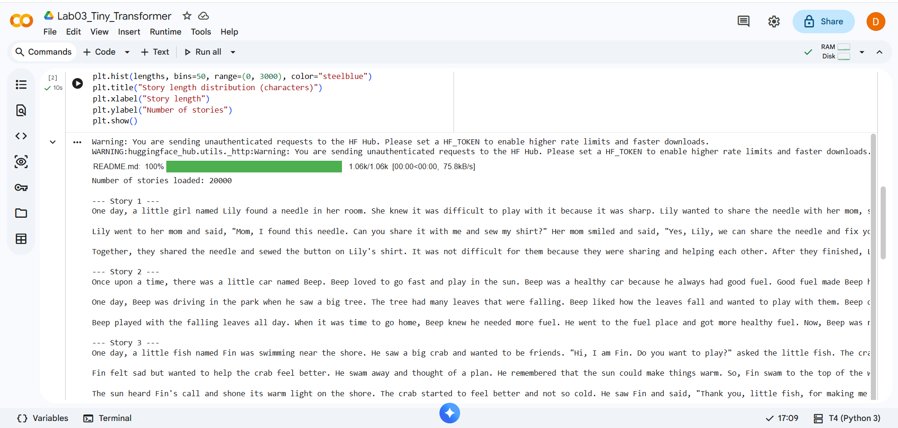

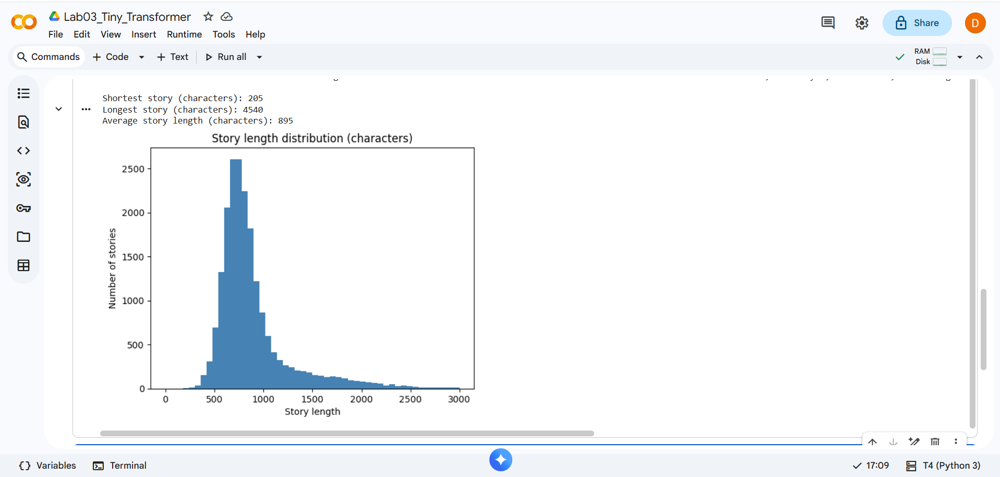

### 4.2 Tokenization and training pairs
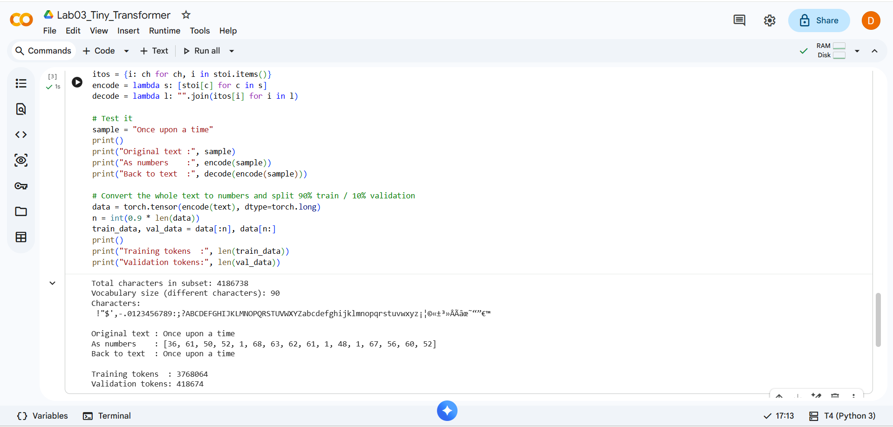

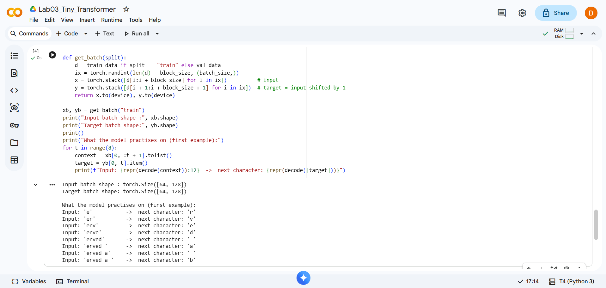

### 4.3 Architecture and model set-up

Click to see the architecture code (4 screenshots)

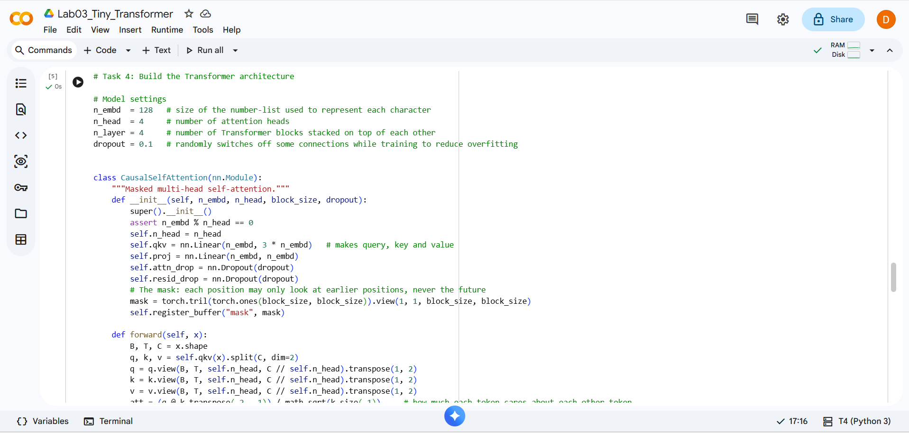

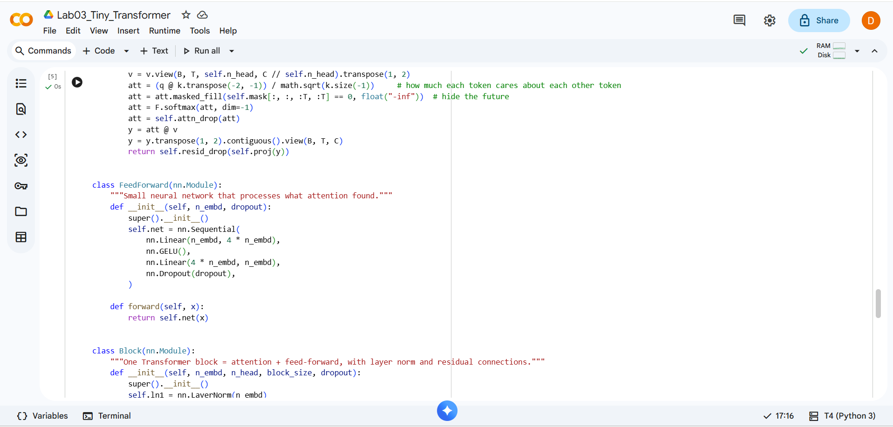

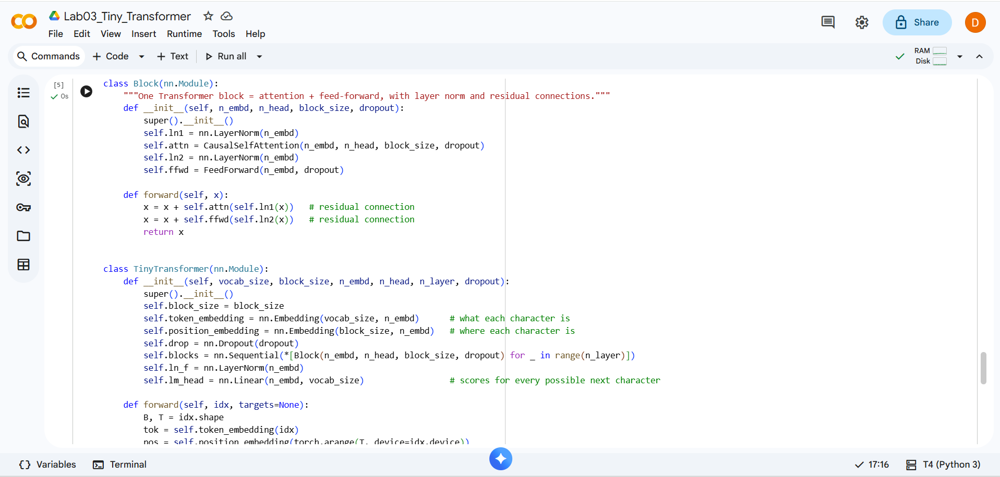

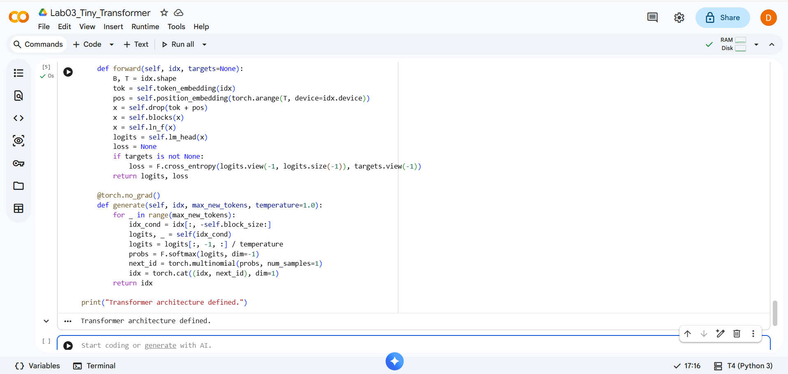

Before training the loss was 4.703, close to the random-guess value of 4.5 (the natural log of 90 characters). This showed that the untrained model was just guessing randomly and that it was set up correctly.

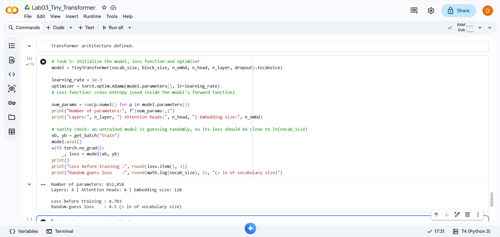

### 4.4 Training and loss curves
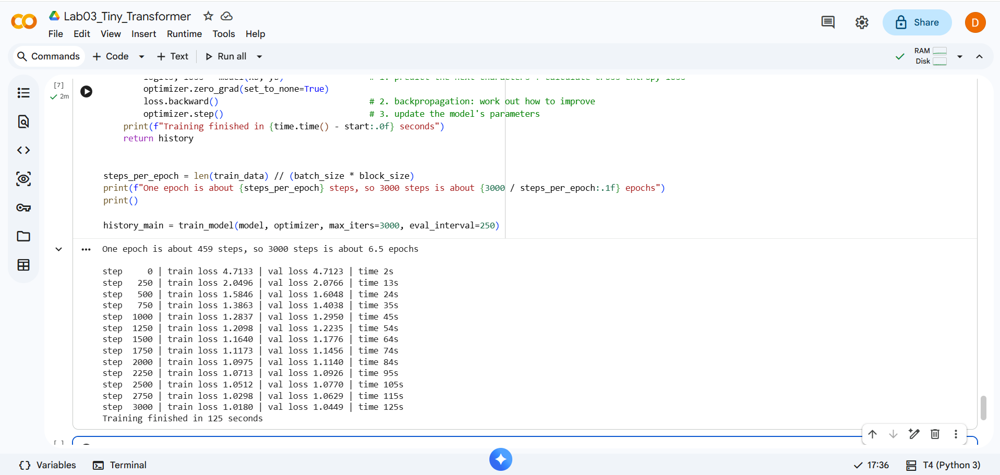

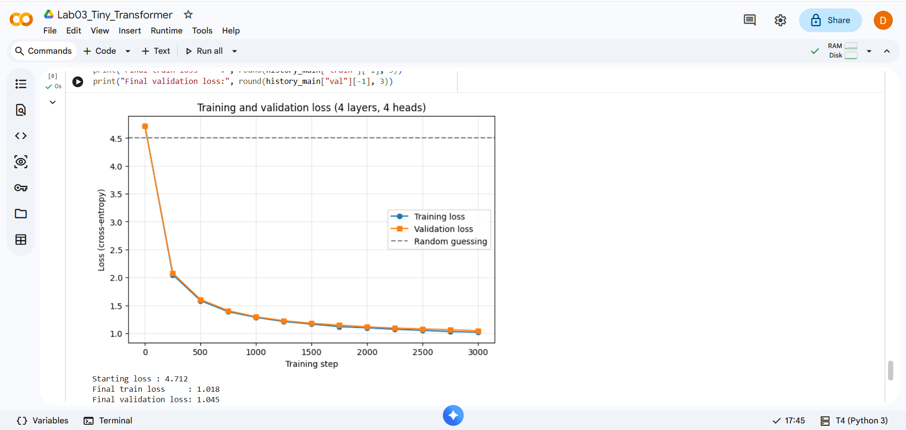

| Measure | Before training | After training |
|---|---|---|
| Loss | 4.71 | Train 1.021, validation 1.048 |
| Perplexity | 111.30 | 2.85 |

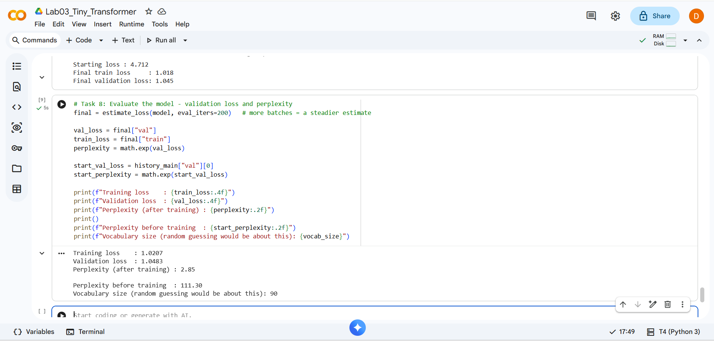

### 4.5 Generated stories
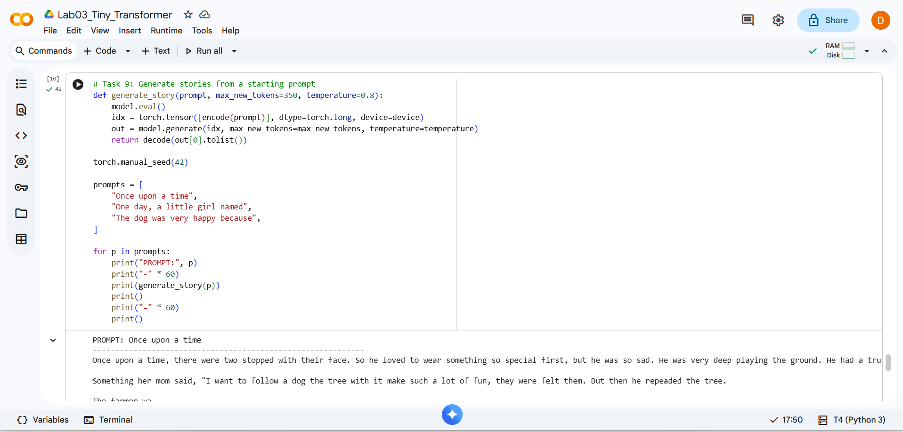

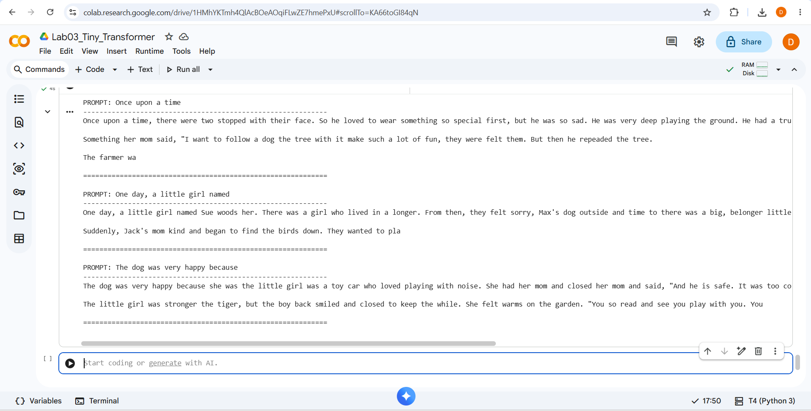

**Effect of temperature** (the higher the temperature, the more adventurous the model is):

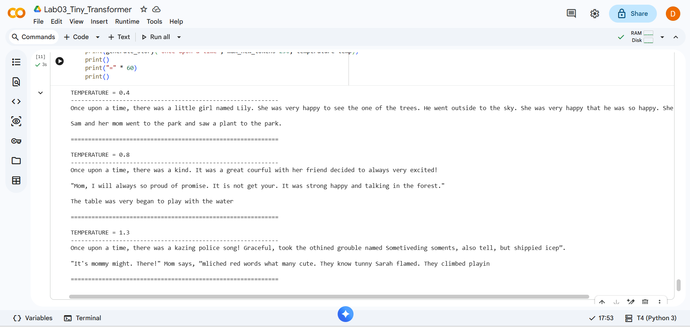

| Temperature | What I saw |
|---|---|
| 0.4 | Tidy, safe sentences, but repetitive ("She was very happy... He was so happy") |
| 0.8 | More varied, but more mistakes ("The table was very began to play with the water") |
| 1.3 | Creative but broken, with made-up words ("kazing police song", "grouble") |

### 4.6 Experiments with model settings
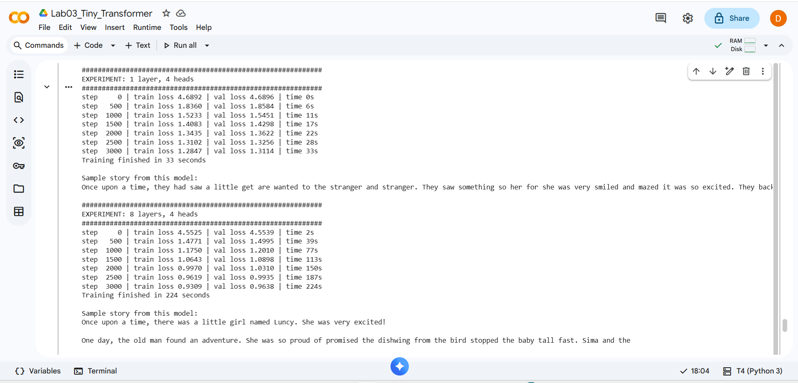

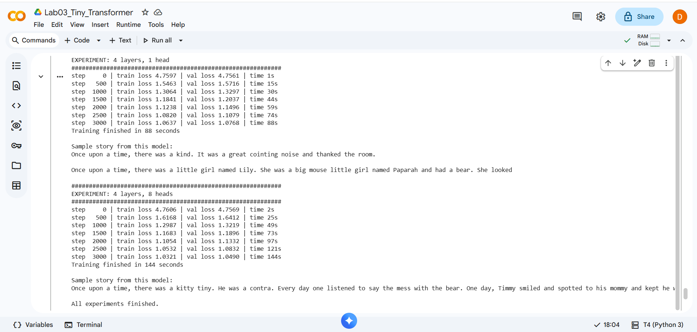

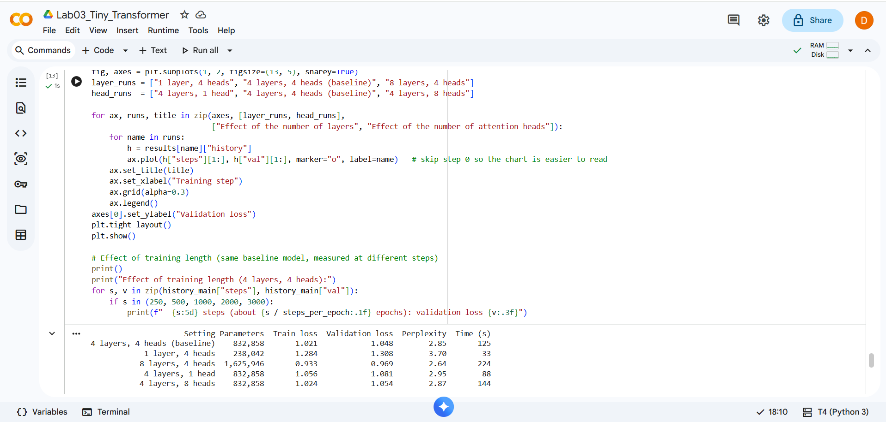

| Setting | Parameters | Train loss | Validation loss | Perplexity | Time |
|---|---|---|---|---|---|
| 1 layer, 4 heads | 238,042 | 1.284 | 1.308 | 3.70 | 33 s |
| **4 layers, 4 heads (baseline)** | 832,858 | 1.021 | 1.048 | 2.85 | 125 s |
| 8 layers, 4 heads | 1,625,946 | 0.933 | 0.969 | 2.64 | 224 s |
| 4 layers, 1 head | 832,858 | 1.056 | 1.081 | 2.95 | 88 s |
| 4 layers, 8 heads | 832,858 | 1.024 | 1.054 | 2.87 | 144 s |

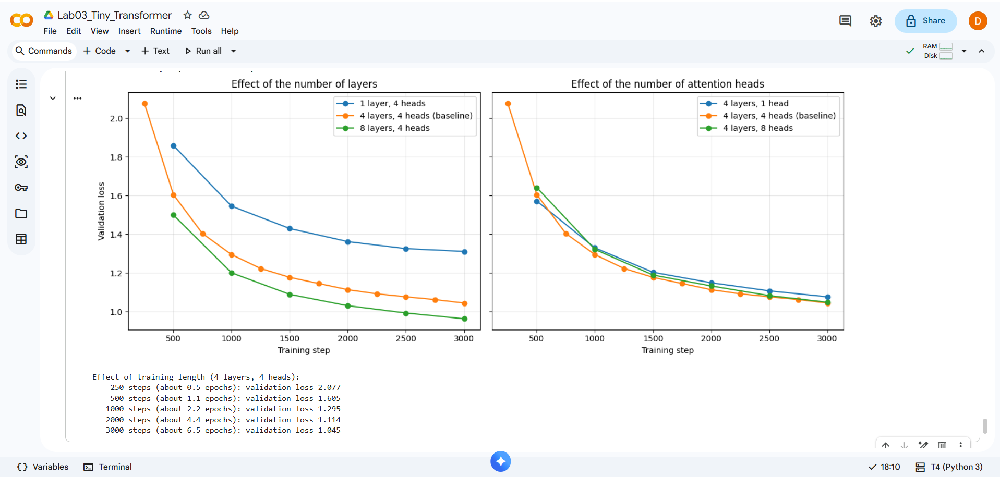

**Effect of training length** (baseline model): validation loss was 2.077 after 250 steps, 1.605 after 500, 1.295 after 1,000, 1.114 after 2,000 and 1.045 after 3,000 steps.

### 4.7 Saved model
The weights (`tiny_transformer_weights.pt`, about 3.5 MB) and the configuration (`tiny_transformer_config.json`) are in the [model](model/) folder. I loaded them into a brand-new model and it produced exactly the same story as the original, which shows that the saving worked.

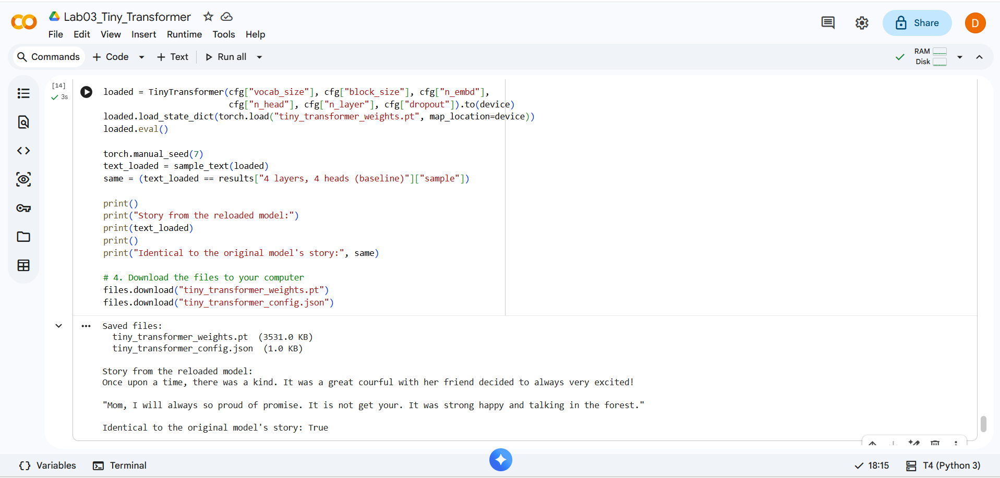

## 5. Observations

**Training worked.** The loss fell from 4.71 (random guessing) to about 1.02, and perplexity fell from 111 to 2.85. In other words, the model went from being confused between about 111 characters to choosing between about 3. Most of the learning happened in the first 500 to 1,000 steps. After that the curve flattened and every extra step gave a smaller gain.

**No overfitting.** The training and validation curves stayed almost on top of each other (1.021 and 1.048). The model learned general patterns, not just the stories it saw.

**The stories look right but mean little.** The model learned the style of children's stories: names like Lily, short sentences, dialogue with quotation marks. But the meaning often drifts, for example "The table was very began to play with the water". It has learned how stories *look*, not what they mean. This is expected for a tiny character-level model trained for two minutes on a small subset of the data.

**More layers helped the most.** Going from 1 to 4 to 8 layers lowered the validation loss from 1.308 to 1.048 to 0.969. The 1-layer model's story was the most broken ("they had saw a little get are wanted to the stranger") and the 8-layer model's was the most fluent. But the cost grew too: the 8-layer model has twice the parameters and took almost twice as long, and the gain from 4 to 8 layers (0.08) was smaller than from 1 to 4 layers (0.26).

**More heads helped only a little.** All the head experiments have the same number of parameters (832,858), because the heads split the same embedding. 1 head was slightly worse (1.081). 4 and 8 heads were almost equal (1.048 and 1.054). In a model this small there is not much for extra heads to specialise in. Because I ran each setting only once, I cannot be sure that the small difference between 4 and 8 heads is real and not just random variation.

**Temperature is a trade-off.** Low temperature gives safe but repetitive text, and high temperature gives creative but broken text. Around 0.8 was the best balance.

### What mechanisms are used to improve performance?

Here is how each part of the model helps (the experiments I ran are marked; for the others I am explaining the purpose of the mechanism as I understand it, because I did not test removing them):

- **Token and positional embeddings:** turn each character into a list of numbers that can be learned, and tell the model where in the sequence each character is. Without positions, the model could not tell "dog bites man" from "man bites dog".
- **Masked self-attention:** lets each character look back at the earlier characters and decide which ones matter for guessing the next one. The mask stops it from peeking at future characters, which would be cheating during training.
- **Multi-head attention:** several attention "viewpoints" at once. In my experiment, 1 head was a little worse than 4, so using several heads helped slightly.
- **Feed-forward layers:** a small network that processes what attention found, giving the model more power to learn patterns.
- **Residual connections:** add each block's input back to its output. This gives the learning signal an easy path through the layers, so deeper models stay trainable. This matters because my 8-layer model trained smoothly and gave the best result.
- **Layer normalisation:** keeps the numbers at a stable size so training is smooth and fast.
- **Dropout (0.1):** randomly switches off some connections during training so the model does not just memorise. This is probably one reason my training and validation losses stayed so close.
- **More layers (tested):** the most effective change, though it costs more time and memory.
- **More training steps (tested):** a big gain early, then smaller and smaller gains.
- **The optimizer (AdamW):** adjusts the learning step for each parameter, which helped the loss fall quickly in the first few hundred steps.

**Limitations:** the model is character-level, trained on only 5,000 stories for 3,000 steps, and each experiment ran once. A word-level tokenizer, more data and longer training would give much better stories. A few odd symbols in the character list come from text-encoding problems in the dataset.

## 6. Learning Outcomes

By completing this lab I learned to:
- load and explore a text dataset and prepare it for next-token prediction,
- explain how text is turned into numbers (tokenization) and why the target is the input shifted by one,
- build the parts of a Transformer and explain what each one does,
- train a language model and read training and validation loss curves,
- explain perplexity, and tell whether a model is learning or overfitting,
- generate text and see how the temperature setting changes it,
- run fair experiments by changing one setting at a time, and explain the results,
- save a trained model and reload it to check that it works,
- see why a tiny model can copy the style of stories without understanding them.
