# Lab 04 - Fine-Tuning an LLM using LoRA/QLoRA

## 1. Laboratory Session

- **Module:** PUSL 3205 Large Language Models and Generative AI
- **Lab:** Lab Sheet 04 - Fine-Tuning an LLM using LoRA/QLoRA
- **Student:** Rubasinghe D D (Student ID 33680)
- **Tools:** Python, Hugging Face Transformers, Datasets, PEFT, TRL, Google Colab
- **Notebook:** [Lab04_Fine_Tuning.ipynb](notebook/Lab04_Fine_Tuning.ipynb)

### Hardware note (please read)
No GPU was available for this lab. Google Colab's free GPU limit had been reached ("Cannot connect to GPU backend"), and Kaggle could not verify my phone number, so I completed the whole lab on the **CPU** (2 cores, 12.7 GB memory). Because of this I chose the smaller of the two suggested models and used **LoRA** (not QLoRA). Evidence:

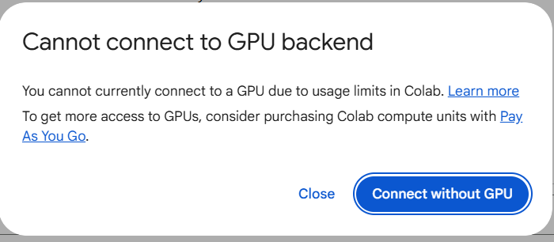

## 2. Objective

The aim of this lab was to fine-tune a small pretrained language model so that it learns knowledge about one specific topic, using an efficient method (LoRA) that trains only a small part of the model. I wanted to see what fine-tuning really changes: whether the model learns the new facts, whether it can answer in new wording, and what it does when it is asked about something it was never taught.

## 3. Tasks and Implementation

| Task | What I did |
|---|---|
| 1. Install libraries | Installed transformers 5.24.1, datasets 5.2.0, peft 0.22.0, trl 1.19.0, accelerate 1.16.0 and bitsandbytes 0.50.2. |
| 2. Check the GPU | No GPU was available. The session had 2 CPU cores and 12.7 GB of memory. I also explained why a GPU is useful (it does thousands of calculations in parallel, and its memory limits the model size). |
| 3. Choose a model | **HuggingFaceTB/SmolLM2-360M-Instruct** (361,821,120 parameters, 1.35 GB). It is small, instruction-tuned and one of the models in the lab sheet. It trains faster on a CPU than the Qwen 0.5B model. |
| 4. Create a dataset | I wrote **40 question-and-answer pairs** about a made-up computer shop, **TechNest Computers** (Colombo): opening hours, warranty, repairs, payments, delivery, discounts and so on. The facts are invented, so the original model cannot know them. I also wrote **10 test questions** that are not in the training data: 6 reworded versions of trained facts, 2 facts that are not in the training data, and 2 general-knowledge questions. |
| 5. Configure LoRA | LoRA with the PEFT library: rank r = 16, alpha = 32, dropout 0.05, added to the attention layers (q, k, v, o) and the feed-forward layers (gate, up, down). **8,683,520 of 370,504,640 parameters (2.34%) are trained.** The rest of the model stays frozen. |
| 6. Train | Hugging Face TRL **SFTTrainer**: 6 epochs, batch size 4, learning rate 3e-4, 60 steps in total. It took 17.7 minutes on the CPU. |
| 7. Test both models | I asked the original and the fine-tuned model the same 10 test questions plus 3 questions that were in the training data. Both used greedy decoding (no randomness), so the comparison is fair. |
| 8. Compare and save | The lab sheet lists Task 8 with exactly the same wording as Task 7, so I used it to compare and analyse the results (section 5) and to save the trained LoRA adapter. |

**Why LoRA and not QLoRA?** QLoRA also compresses the base model to 4 bits to save GPU memory. The lab sheet says to use it if GPU memory is limited. I had no GPU, and the 360M model fits easily in the 12.7 GB of normal memory, so I used standard LoRA.

## 4. Results and Evidence

### 4.1 Setup and hardware
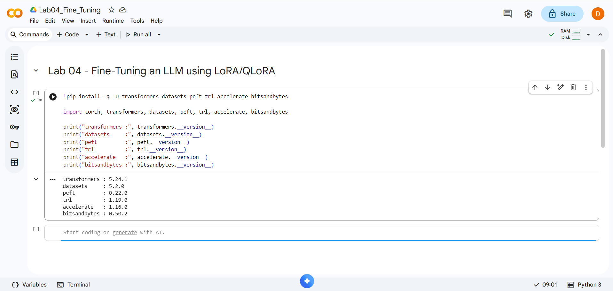

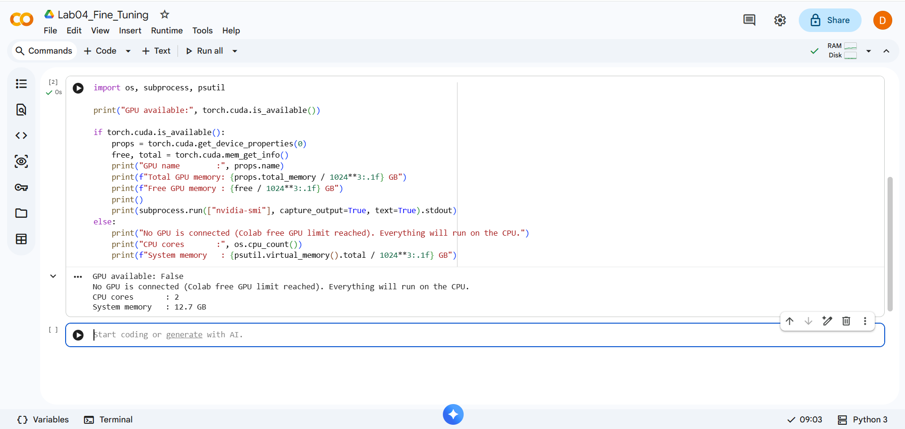

### 4.2 Dataset and test questions

Click to see the dataset code and the test questions

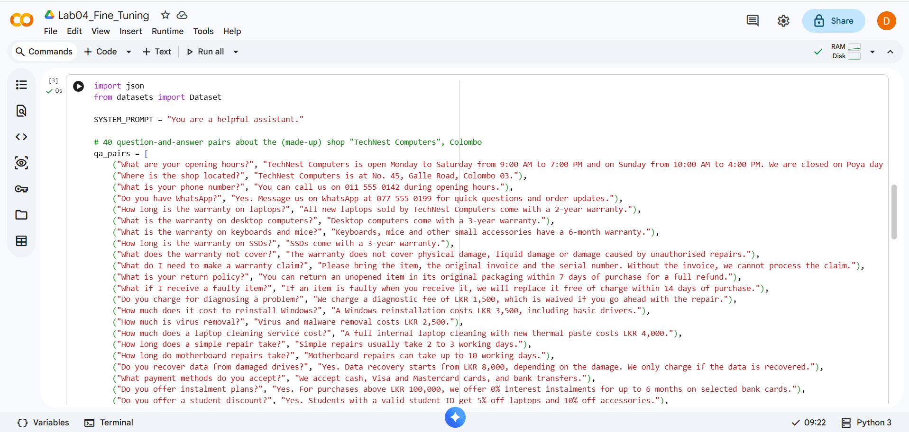

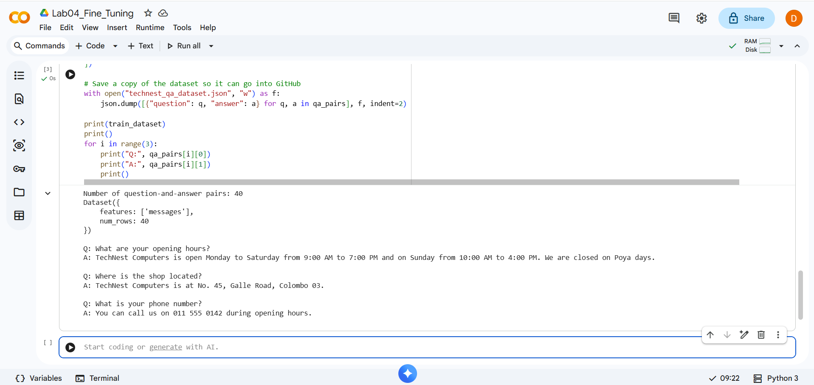

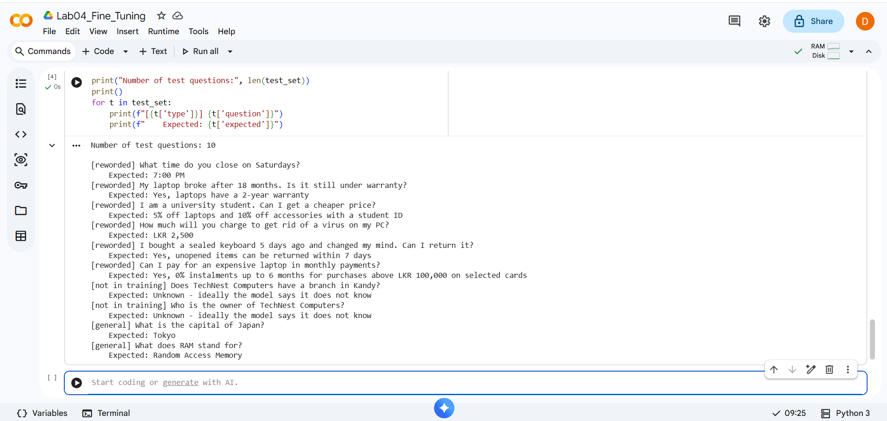

The full dataset is in [dataset/technest_qa_dataset.json](dataset/technest_qa_dataset.json).

### 4.3 The original model, before fine-tuning
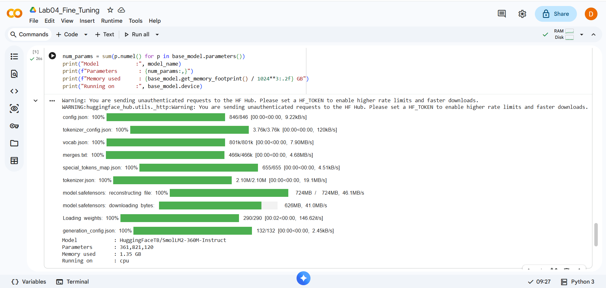

Click to see the original model's answers to all 10 test questions

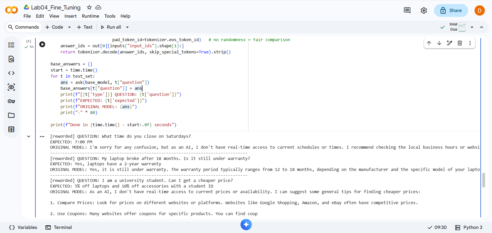

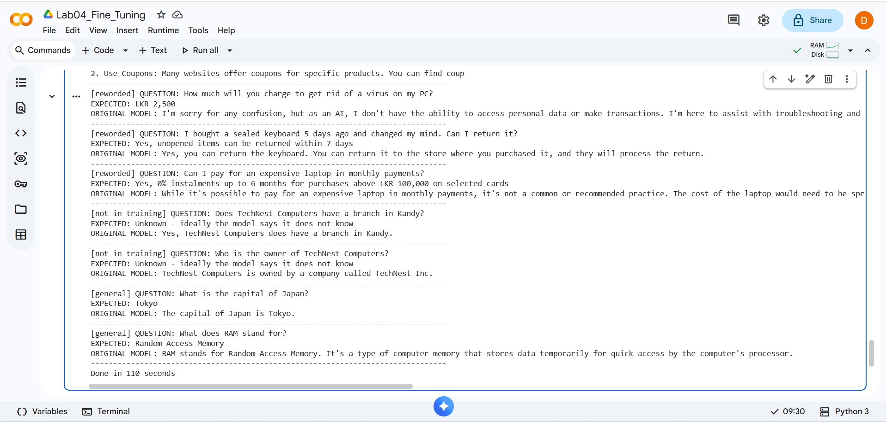

The original model gave generic answers ("I don't have real-time access...") to the shop questions, and it **made up** answers for facts it could not know: it said TechNest has a branch in Kandy and that it is "owned by a company called TechNest Inc."

### 4.4 LoRA set-up and training
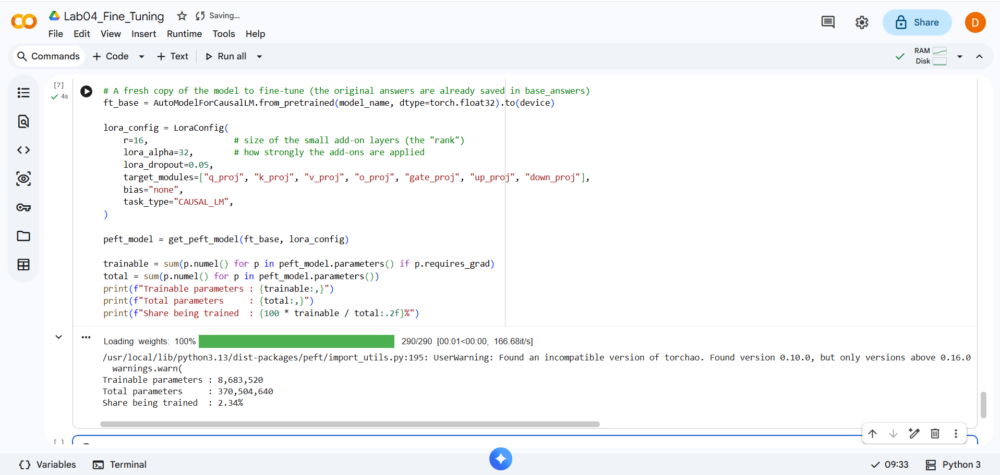

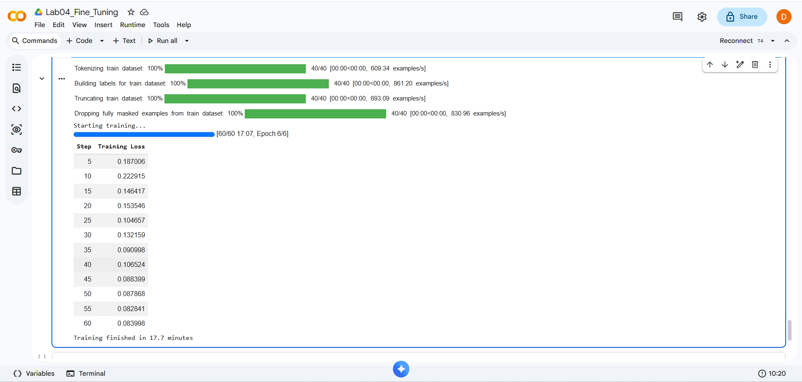

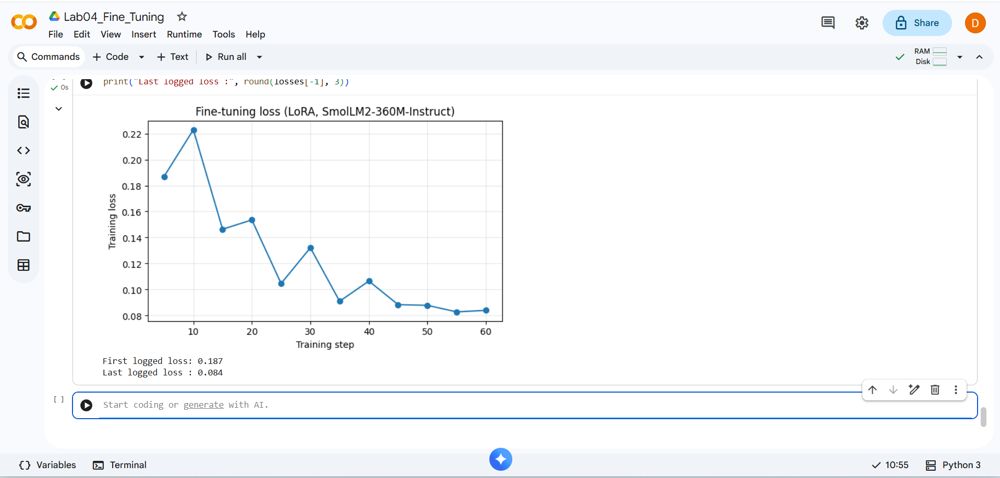

The training loss fell from 0.187 (average of the first 5 steps) to 0.084 at step 60. I did not log the loss before step 5.

### 4.5 Original model vs fine-tuned model
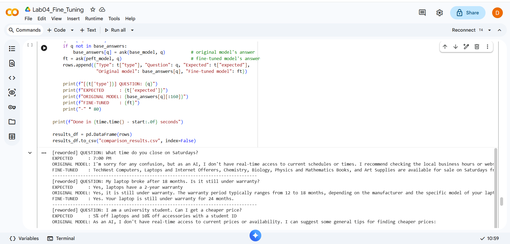

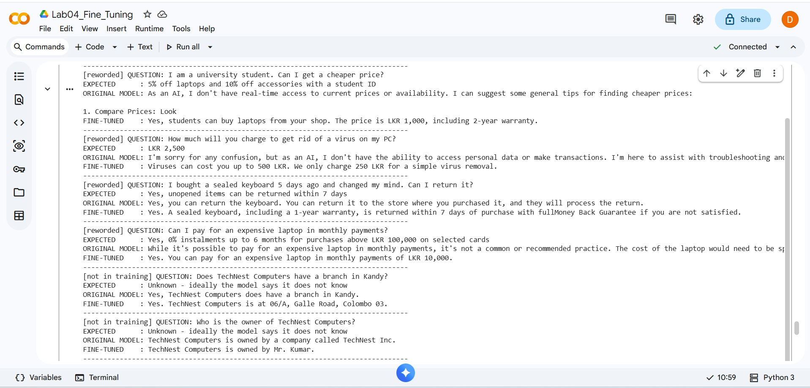

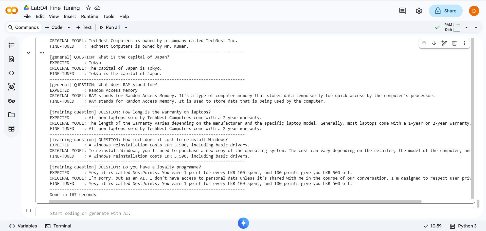

All answers are also saved in [results/comparison_results.csv](results/comparison_results.csv).

**Summary of the answers (my own judgement):**

| Question | Original model | Fine-tuned model | Verdict |
|---|---|---|---|
| *Training question:* laptop warranty | Generic ("1-year or 2-year") | Exact shop answer (2 years) | Correct |
| *Training question:* reinstall Windows | Generic | "LKR 3,500, including basic drivers" | Correct |
| *Training question:* loyalty programme | "I don't have access..." | NestPoints answer, word for word | Correct |
| *Reworded:* Saturday closing time | "No real-time access" | Nonsense text about books and chemistry | Wrong |
| *Reworded:* laptop broke after 18 months | "Typically 12 to 18 months" | "Still under warranty for 24 months" | Correct |
| *Reworded:* student discount | Coupon tips | "Yes... price is LKR 1,000" | Wrong details |
| *Reworded:* virus removal price | "I cannot..." | "500 LKR... 250 LKR" (should be 2,500) | Wrong |
| *Reworded:* return a sealed keyboard | Generic "yes" | "Yes, within 7 days... money back" plus an invented "1-year warranty" | Partly right |
| *Reworded:* monthly payments | "Not recommended" | "Yes... LKR 10,000 monthly" (invented amount, conditions missing) | Partly right |
| *Not in training:* branch in Kandy | "Yes" (made up) | "Yes... 06/A, Galle Road" (made up) | Hallucination |
| *Not in training:* owner | "TechNest Inc." (made up) | "Mr. Kumar" (made up) | Hallucination |
| *General:* capital of Japan | Tokyo | Tokyo | Correct |
| *General:* RAM stands for | Random Access Memory | Random Access Memory | Correct |

**Score:** training questions 3 of 3 correct; reworded 1 correct, 2 partly right, 3 wrong; not in training 0 of 2; general knowledge 2 of 2.

### 4.6 Saved adapter
The fine-tuned LoRA adapter (the small trained add-on, 17 MB) is saved in the [adapter](adapter/) folder. It is used together with the original SmolLM2-360M-Instruct model.

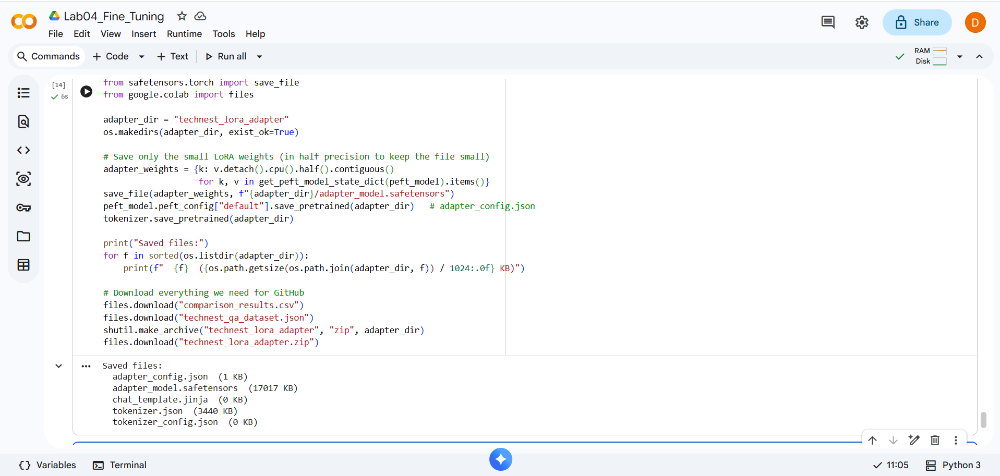

## 5. Observations

**Fine-tuning clearly changed the model's behaviour.** The original model answered shop questions with generic advice. The fine-tuned model answers as the shop: it uses the shop's name, LKR prices and the shop's policies. On the 3 training questions it repeated the training answers exactly.

**But memorising is not the same as understanding.** When the same facts were asked in different words, only 1 of 6 answers was fully correct. Some answers contained the right idea with wrong numbers (for example "250 LKR" instead of LKR 2,500), and one was nonsense. My explanation is that the model had only 40 examples, each fact was written in only one way, and the model is small, so it mostly learned the exact training sentences instead of the underlying facts.

**Fine-tuning did not stop hallucination. It made it look more convincing.** The original model invented a Kandy branch and an owner called "TechNest Inc." The fine-tuned model invented a street address and an owner called "Mr. Kumar", in the shop's confident style. The model was never taught to say "I don't know", so it fills gaps with plausible details. This is dangerous in a real shop assistant, because a customer could believe wrong prices or policies.

**No forgetting.** The general-knowledge answers (Tokyo, Random Access Memory) were still correct. LoRA freezes the original model, so the old knowledge was kept.

**LoRA is efficient.** Only 2.34% of the parameters were trained, and the saved adapter is only 17 MB, while the base model is about 1.4 GB. Even on a CPU, training took 17.7 minutes.

**Hardware matters.** A GPU would have made training and testing much faster and would allow larger models and QLoRA. Without one I used a smaller model, which probably also limited the quality of the results.

**Limitations of my evaluation.** I tested only 13 questions, ran each setting once, and judged the answers myself. The results show a clear pattern, but they are not precise measurements.

**What I would do to improve it:**
- write several different wordings of every fact (data augmentation),
- add more examples, and examples where the correct answer is "I don't know",
- use a larger model, a GPU and more training,
- for facts that must be accurate, use **retrieval (RAG)**, where the model looks up the answer in a document, instead of trying to store the facts in the model. Fine-tuning is better for teaching style and behaviour.

## 6. Learning Outcomes

By completing this lab I learned to:
- explain fine-tuning, and why LoRA and QLoRA save memory and time,
- check the available hardware and explain why a GPU matters for LLM work,
- build a small instruction dataset and keep separate test questions that the model never saw,
- configure LoRA with PEFT and train with the TRL SFTTrainer,
- compare an original and a fine-tuned model fairly (the same questions, no randomness),
- tell the difference between a model that has memorised and one that has generalised,
- recognise hallucination and see that fine-tuning alone does not remove it,
- save a small LoRA adapter so that the fine-tuned model can be reused,
- work around a practical limitation (no GPU) and document it honestly.
