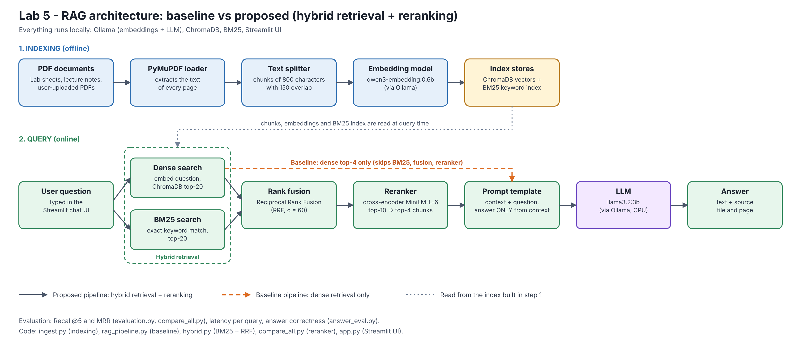

# Technical Report – Group 1: Hybrid Retrieval and Reranking

**Module:** PUSL 3205 – Large Language Models and Generative AI  |  **Lab 5 – RAG Architecture**
**Student:** Rubasinghe D D (ID 33680)  |  Completed individually, 28 November 2026

## 1. Aim
Improve the retrieval stage of a basic RAG system by combining BM25 keyword search with vector search, fusing the two rankings and reranking the result, then compare it with the basic (dense-only) RAG on **Recall@5, MRR, answer correctness and latency**.

## 2. System design

| Stage | Baseline RAG | Proposed system |
|---|---|---|
| Documents | PDFs loaded with PyMuPDF, split into 800-character chunks (150 overlap) | same |
| Embeddings / store | `qwen3-embedding:0.6b` via Ollama, ChromaDB | same, plus a BM25 keyword index over the same chunks |
| Retrieval | Dense search, top-4 | Dense top-20 **+** BM25 top-20 |
| Fusion | none | Reciprocal Rank Fusion, score = Σ 1 / (60 + rank) |
| Reranking | none | Cross-encoder `ms-marco-MiniLM-L-6-v2` re-scores the top-10 fused chunks; the top-4 go to the LLM (the retrieval metrics score the top-5) |
| Generation | `llama3.2:3b` via Ollama, temperature 0, prompt: "answer ONLY from the context, otherwise say you could not find it" | same |

Everything runs locally on a CPU (Intel Iris Xe laptop, no NVIDIA GPU, 16 GB RAM).

*Note:* in the Streamlit app (`../code/app.py`) the "Hybrid" mode uses BM25 + dense search + RRF only. The reranker is part of the evaluation scripts (`compare_all.py`, `answer_eval.py`).

## 3. Evaluation setup
- **Corpus:** Lab sheet 1, Lab sheet 2, Week 1 lecture notes, later also Lab sheet 5 (4 PDFs, 58 chunks).
- **Retrieval test:** 12 questions. A retrieved chunk is relevant if it comes from the expected PDF and contains the expected phrase. Recall@5 = fraction of questions with a relevant chunk in the top 5; MRR = mean of 1 / rank of the first relevant chunk. Latency = mean retrieval time per query after a warm-up call.
- **Answer test:** 11 of the questions were asked to the real LLM (top-4 chunks) with the baseline and the proposed system. An answer was marked correct automatically if it contained the expected key words, and I then read all answers myself (`../results/answer_results.txt`).

## 4. Results

| System (58 chunks) | Recall@5 | MRR | Retrieval latency |
|---|---|---|---|
| Dense only (baseline) | 0.83 | 0.507 | 175 ms |
| BM25 only | 1.00 | 0.792 | ~0 ms |
| Hybrid (BM25 + Dense, RRF) | 1.00 | 0.819 | 176 ms |
| **Hybrid + Rerank (proposed)** | **1.00** | **0.958** | 589 ms |

An earlier run on the first 3 PDFs (48 chunks) gave the same ordering: Dense 0.92 / 0.618, BM25 1.00 / 0.847, Hybrid 1.00 / 0.861 (Recall@5 / MRR).

| End-to-end answers (11 questions) | Keyword check | Manual reading | Refusals | Avg time per query |
|---|---|---|---|---|
| Dense (baseline) | 8 / 11 | 6 correct, 2 partial, 3 failed | 2 | 7.7 s |
| **Hybrid + Rerank** | **10 / 11** | **10 correct**, 1 refusal | 1 | 9.6 s |

## 5. Discussion
1. **Hybrid search fixes lexical misses.** The question about the Lab sheet 1 duration and language was missed completely by dense search (the chunk text never contains "Lab sheet 1") but BM25 can match exact words such as "programming language": it ranked the right chunk 3rd, and in the first run the hybrid system ranked it 1st.
2. **Reranking improves ranking, not coverage.** Recall@5 was already 1.00 for BM25 and hybrid; the cross-encoder raised MRR from 0.819 to 0.958, meaning the correct chunk was almost always first. This matters because only 4 chunks reach the small LLM.
3. **The cost is small.** Reranking added about 410 ms per query, and the whole pipeline took 9.6 s per question against 7.7 s for the baseline, because the LLM dominates the time.
4. **BM25 alone was strong on this test set.** It nearly matched the hybrid on MRR (0.792 vs 0.819). The test questions share many exact words with the documents (they were written after reading the chunks), which favours keyword search, so the size of the hybrid's advantage over BM25 should not be over-interpreted.
5. **Dense retrieval degraded when the corpus grew** (Recall@5 0.92 → 0.83 after adding Lab sheet 5), while BM25, the hybrid and the reranked system all kept Recall@5 at 1.00.
6. **Generation is a separate failure point.** In one case the right chunk was ranked first and the 3B model still refused to answer; in another case the proposed system refused a question the baseline answered. I did not investigate the second case.

## 6. Limitations
Small evaluation sets (12 and 11 questions), one run, a small corpus, questions biased towards exact words, a partly automatic answer check, and CPU-only inference with a 3B model. A larger and more varied (paraphrased) question set, a second grader and repeated runs would be needed before drawing strong conclusions.

## 7. Conclusion
On my test set, adding BM25, rank fusion and a cross-encoder reranker to a basic dense RAG improved Recall@5 from 0.83 to 1.00, MRR from 0.507 to 0.958 and end-to-end correct answers from 6 to 10 out of 11 (manual reading), for roughly 0.4 s extra retrieval time and about 2 s extra per answer. The result is encouraging but limited by the small, keyword-friendly evaluation set.
